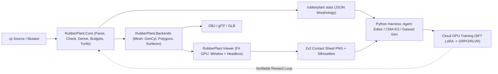

# RubberPlant → AI/ML L-System Battle Plan

> **Starting point:** RubberPlant v0.2 (`master` / `295bab8`) — ABOP Chapters 1–3 implemented in pure F#, deterministic cross-platform geometry, SVG/OBJ/glTF output, Native AOT CLI, and `rubberplant batch` (~11 ms/model).
> **Hardware split:** Local **RTX 4070 Laptop (8 GB VRAM, 64 GB RAM)** for fast 3D rendering, synthetic dataset generation, local small-model inference, and training-script smoke tests; **rented cloud GPU (24–48 GB VRAM, ~USD 20–50 budget)** for real fine-tuning runs.

---

## Guiding Principles

1. **Spec first, code second.** Every phase begins with a short spec doc before writing code, matching [`roadmap.md`](roadmap.md) and [`language.md`](language.md).
2. **One repo, one language (`.rp`).** All F# projects (`RubberPlant.Core`, `RubberPlant.Backends`, `RubberPlant.Cli`, `RubberPlant.Viewer`, `RubberPlant.Synth`) live together in `RubberPlant`. Models author and edit `.rp` directly—never raw `.s` control-point dumps and never verbose JSON ASTs.
3. **Pure F# core, thin I/O shells.** Computation, budgets, geometry metrics, and AST mutation stay pure and deterministic in F#; rendering, agent orchestration, and ML training stay decoupled at the edges.
4. **Measure before training.** Push zero-training agents and black-box optimization (CMA-ES) first so every fine-tuning run has a concrete baseline to beat.

---

## Target Architecture

---

## Phase 1: Core Hardening & Morphology Telemetry

**Goal:** Make RubberPlant safe to drive automatically by agents, optimizers, and mutators, and expose deterministic 3D metrics.

### Scope (`RubberPlant.Core` + `RubberPlant.Cli`)
- **Execution guardrails:** Add `--max-modules <N>` and `--max-primitives <N>` with **generous defaults on by default** (overridable via CLI, e.g., to raise/lower or disable for giant renders), checked inside [`Derivation.fs`](../src/RubberPlant.Core/Derivation.fs) and [`Turtle.fs`](../src/RubberPlant.Core/Turtle.fs). Exceeding a budget returns a clean diagnostic error (exit code `1`) without crashing or wedging `rubberplant batch`.
- **`rubberplant stats` command:** A pure analyzer over `Derived` + `Geometry` (plus optional branch-depth tagging in `Turtle`) emitting compact, deterministic JSON:
  - *Derivation:* module count, max bracket depth, rule firing summary, fixed-point reached (`bool`).
  - *Geometry:* 3D bounding box (`min`, `max`, `extent`), height, crown width (X/Z spread), height-to-width aspect ratio, segment count, polygon count, total segment length, width min/max, center of mass / lean vector, branch-order distribution.
- **Keep `batch` protocol clean:** `stats` works inside `rubberplant batch` identically to `check`/`derive`/`render`.

### Exit Criteria
- Exponentially exploding `.rp` grammars fail cleanly in milliseconds and leave `rubberplant batch` healthy for subsequent commands.
- All 40 existing examples pass `rubberplant stats` with deterministic, cross-platform JSON output.

---

## Phase 2: Direct-from-`.rp` CLI-Driven 3D Viewer

**Goal:** Retire SVG as the primary inspection tool and give both you and AI agents a fast, direct `.rp` → GPU 3D renderer with zero OBJ/glTF round-trip.

### Scope (`src/RubberPlant.Viewer`)
- **In-memory pipeline:** References `RubberPlant.Core` and `RubberPlant.Backends` directly (`compile` → `run` → `Mesh.build` → GPU VBO/IBO upload). Full reload in ~10–20 ms; camera re-render in <1 ms on the RTX 4070.
- **One rendering core, two modes:**
  - **Headless / offscreen mode:** Renders to a GPU framebuffer and writes PNGs or binary silhouette masks with no window (ideal for agent loops, CMA-ES, and dataset generation).
  - **Interactive window mode:** Same renderer drawn to a window with mouse orbit/zoom, while still accepting live CLI/stdin/IPC commands.
- **Unified command protocol** (same style as `rubberplant batch`):
  - `load <file.rp>` (plus optional overrides: `derivations <n>`, `seed <n>`, `width-scale <k>`)
  - `camera <az> <el> [dist]` / `fit` / `wireframe on|off` / `grid on|off`
  - `snapshot <out.png>` (single view)
  - `contact-sheet <out.png>` (**2×2 grid:** Front | Side +90° | 3/4 Iso | Top-Down, auto-framed, clean directional + hemisphere lighting, subtle ground grid/scale)
  - `silhouette <out.png>` (crisp binary/alpha mask for fast CMA-ES scoring)
  - `stats` (prints the Phase 1 JSON sidecar alongside visuals)

### Open Technical Decision (Deferred to Phase 2 Spec)
- **GPU binding in F# (.NET 10):** Evaluate candidates (e.g., **Silk.NET OpenGL**, **Raylib-cs**, **Veldrid**) for headless offscreen support and Native AOT compatibility on Windows when we begin speccing Phase 2.

### Exit Criteria
- You can inspect any `.rp` file interactively in 3D without generating `.obj`/`.glb`.
- Headless batch rendering of 2×2 contact sheets across all 40 examples completes in a few seconds on the RTX 4070.
- An agent can issue one command and get back both a 2×2 multi-view PNG and exact `stats` JSON.

---

## Phase 3: ABOP v0.3 (Chapters 4–6) & High-Quality 3D Output

**Goal:** Bring 3D plant visuals up to botanical quality (smooth tapered branches + curved 3D organs) while staying strictly grounded in textbook ABOP/`lpfg` geometry—no speculative custom surface language.

### 3A. Generalized Cylinders (Closed + Open Contours)
- **Closed circular contour:** Replace disconnected constant-width tubes in [`Mesh.fs`](../src/RubberPlant.Backends/Mesh.fs) with smooth, tapered, joined generalized cylinders along connected branch paths (standard `lpfg` `StartGC` / `EndGC` semantics).
- **Open contours (flat, U-cup, V-fold):** Reuse the *exact same* swept-contour mesh builder so `.rp` turtle rules can sweep smooth, arched, twisted 3D leaves, grass blades, and petals using `!(w)` for width profiles and named `let` constants (`leaf_len`, `leaf_width`, `leaf_arch`, `leaf_cup`).
- **Staged commitment check:** Author ~10 real leaves/petals in pure `.rp` first and inspect them in `RubberPlant.Viewer`. *Only* add a thin declarative `surface` shorthand (compiling down to the same swept-contour builder) if pure `.rp` spine loops prove too noisy for humans or agents.

### 3B. Predefined Bicubic Surfaces (`.s` / `~H`)
- Standard bicubic Bézier patch evaluator + `.s` loader for faithful reproduction of ABOP Ch 4–5 historical figures (crocus, lily, lilac, rose, sunflower).
- In agent/ML workflows, treat `.s` strictly as a small read-only asset library for complex deeply lobed organs (e.g., `~oak_leaf`, `~maple_leaf`) that `.rp` instantiates and scales—never ask models to author raw `.s` control points.

### 3C. ABOP Chapter 4 (Phyllotaxis) & Chapter 6 (Animation)
- Implement remaining Ch 4 & Ch 6 features (timed/developmental stepping), using `RubberPlant.Viewer` to scrub growth steps and export frame sequences.
- *(ABOP v0.4 Chapters 7–8 — map L-systems and fractals — remain cleanly decoupled; tackle either right after Ch 6 or in parallel with Phase 4 whenever you feel like it.)*

### Exit Criteria
- Trees have smooth tapered trunks/limbs with no wedge gaps at bends.
- Leaves, grasses, and petals render cleanly in 3D and can be edited via readable `.rp` parameters.
- All Ch 4–6 examples are verified in 3D and exported cleanly to glTF/GLB.

---

## Phase 4: Zero-Training Agent Loop, Seed Corpus & Hybrid Image Search

**Goal:** Discover how far pretrained models + RubberPlant’s verifier/viewer go *with zero training*, build a rigorous evaluation benchmark, and solve the grammar-diversity bottleneck.

### 4A. Agentic L-System Editor & Generator (Python Harness)
- Thin Python orchestrator talking to `rubberplant batch` + `RubberPlant.Viewer` (headless).
- **Iterative loop (2–3 turns max):**
  1. Prompt a strong pretrained coding/VLM model with a compact [`language.md`](language.md) reference + 10–15 exemplar `.rp` files + user request (edit or create).
  2. Run `check` + budgeted `stats`; feed any compiler/budget errors straight back to the model.
  3. Render a 2×2 contact sheet PNG + `stats` JSON; let the VLM critique against the request and refine once.
- **Benchmark suite (save this for Phase 5!):** ~30–50 graded tasks split across:
  - *Parameter edits* ("wider crown, same height", "droopier branches")
  - *Structural edits* ("add secondary twigs", "make branching stochastic")
  - *From-scratch text generation* ("tall narrow spruce", "weeping willow", "flowering fern")
  - Track compile rate, budget pass rate, measured `stats` compliance, and human/VLM visual rating.

### 4B. Seed Library Expansion (~12 → ~40–60 Distinct Plant Families)
- Use the editor loop + manual curation to build a clean corpus of **40–60 genuinely distinct plant archetypes** (conifers, broadleaf deciduous, weeping trees, shrubs/bushes, palms, ferns, grasses, flowering herbaceous plants, bonsai/gnarled forms), each written idiomatically with descriptive `let` constants.

### 4C. Hybrid Image → L-System (VLM Proposal + CMA-ES)
- Given a target image (start with held-out synthetic renders for ground-truth testing, then move to real tree silhouettes/photos):
  1. VLM selects or adapts a `.rp` grammar family with exposed numerical `let` constants.
  2. **CMA-ES** optimizes those constants in parallel across headless `RubberPlant.Viewer` workers against a loss combining **multi-scale silhouette IoU + distance transform + `stats` proportions** (fixed seed during search, multi-seed verification at the end).

### Exit Criteria
- Documented zero-training baseline scores across your benchmark suite (showing exactly where unfine-tuned models struggle).
- 40–60 clean, diverse `.rp` grammar families checked into a dataset/archetypes directory.
- Working CMA-ES parameter fitter matching held-out synthetic tree silhouettes.

---

## Phase 5: Synthetic Dataset & Model Fine-Tuning

**Goal:** Train a compact model (e.g., Qwen3.5-4B or 7B–8B VLM/code model) that genuinely understands `.rp` L-systems and beats unfine-tuned baselines on **unseen grammar families**.

### 5A. F# AST Pretty-Printer & Controlled Mutator (`RubberPlant.Synth`)
- Pure round-tripping pretty-printer for [`Ast.fs`](../src/RubberPlant.Core/Ast.fs) (verified against all examples).
- Type-safe synthetic generators:
  - **Parameter variations:** Systematic sampling of `let` constants, angles, contraction ratios, tropism, and seeds.
  - **Structural variations:** Controlled grammar mutations (adding/pruning branching tiers, toggling stochastic `weight` branches, swapping monopodial/sympodial patterns) filtered immediately by `check` + budgets + `stats` plausibility.
- **Strict train/val/test split by grammar family**—never split by rendered image or parameter tweak.

### 5B. Geometry-Grounded Training Datasets (Generated Locally on RTX 4070)
1. **Edit dataset (start here):** Mutate a seed `.rp` → run both before & after through `stats` + `RubberPlant.Viewer` → discard broken/trivial/exploded pairs → generate natural-language edit instructions grounded in the *actual measured geometric delta* (optionally enriched by a VLM viewing before/after contact sheets).
2. **Generation dataset:** 5,000–20,000 diverse, plausibility-filtered plants across all 40–60+ families → 2×2 contact sheets + single-view shaded renders + `stats`-grounded captions.

### 5C. Training Pipeline (Smoke-Test Local → Train in Cloud)
1. **Local sanity check (RTX 4070, 8 GB):** Verify tokenization, formatting, loss decrease, and checkpointing on a tiny model/subset so zero cloud dollars are spent debugging.
2. **Stage 1 — Supervised Fine-Tuning (Cloud 24–48 GB GPU):** bf16 LoRA directly on `.rp` text for both editing (`(source, instruction) → edited_source`) and generation (`(description [, image]) → source`).
3. **Stage 2 — Verifiable-Reward RL (GRPO / RLVR, optional high-upside pass):** Use RubberPlant’s ~11 ms verifier as the reward function:
   - Compiles with 0 errors/warnings?
   - Within module/primitive budget?
   - Matches target `stats` deltas / silhouette IoU?
4. **Evaluation:** Score on the Phase 4 benchmark and held-out grammar families against both the unfine-tuned base model and your frontier baseline.

### Exit Criteria
- Fine-tuned 4B–8B model runs locally on your RTX 4070 (quantized) and outperforms the unfine-tuned base model on unseen grammar families for compile rate, edit fidelity, and visual match.

---

## Antigravity Workflow & Execution Strategy

### Setup Before Starting Phase 1
- **Project workspace:** Open `C:/code/RubberPlant` as a **Project** in Antigravity so project-level permissions, sandboxing, and workspace customizations activate automatically.
- **Durable Rules + Skills:** Always-on invariants live in [`AGENTS.md`](../AGENTS.md) (spec-first, pure core / CLI I/O, Native AOT `%s` printf rule, `uv` for Python, branch/PR conventions), and on-demand runbooks live in `.agents/skills/` (`verify-and-goldens`, `cpfg-verification`).
- **Scoped conversations:** Keep one conversation per spec or PR, grounded in `docs/` files in git; use `@` mentions for files or prior conversations, `/compact` on long threads, and `/learn` whenever you correct a recurring convention.

### Slash Command Map by Phase

- **`/grill-me`** — Before drafting any new spec (interactive interview to nail down edge cases and design choices).
- **`/plan`** — Before implementing a single well-scoped PR.
- **`/boost`** — Deep thinking, math/architecture rigor, and multi-perspective verification on hard design problems.
- **`/teamwork`** — Parallel swarm of workers when work splits cleanly into independent tracks.
- **`/goal`** — Long unattended verification loops (e.g., grinding examples until `cpfg` diffs, glTF validator, and tests all pass).

| Phase | Focus | Key Deliverable | `/boost` | `/teamwork` | Recommended Primary Mode |
|---|---|---|---|---|---|
| **1** | Core hardening | Budgets (`--max-modules`/`--max-primitives`) + `rubberplant stats` | No | No | `/grill-me` (spec) → `/plan` (PRs) |
| **2** | 3D viewer | `RubberPlant.Viewer` (direct `.rp` → GPU, window + headless, 2×2 contact sheet) | **Spec** (GPU stack, headless FBO, Native AOT) | Optional | `/boost` (spec) → `/plan` (implementation) |
| **3** | ABOP v0.3 + 3D | Generalized cylinders (closed + open contours), `.s` compat, Ch 4 & 6 | **Yes** (frame transport, bicubic normals/stitching) | **Yes** (parallel `.s`, GenCyl, Ch 4/6 examples, cpfg checks) | `/boost` (spec/math) → `/teamwork` or `/goal` (build & verify) |
| **4** | Zero-training AI | Python agent editor, 40–60 seed families, CMA-ES image fitter, benchmark | **Yes** (CMA-ES loss & eval design) | **Yes — killer fit** (40–60 plant families + harness + CMA-ES in parallel) | `/teamwork` + `/boost` |
| **5** | Model training | F# AST mutator, RTX 4070 synthetic data, cloud LoRA (+ GRPO) | **Yes** (family splits, leakage prevention, GRPO rewards) | **Yes** (mutator, dataset builder, eval harness) | `/boost` (design) → `/teamwork` (pipeline) |
