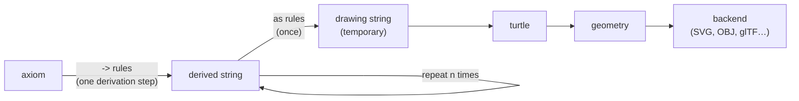

# RubberPlant L-system language

Status: **draft v0.1**. Covers ABOP Chapter 1 (§1.1–§1.10). Later chapters extend it.

Source of truth for semantics: *The Algorithmic Beauty of Plants* (Prusinkiewicz & Lindenmayer, 1990), "ABOP" below. Section refs like §1.8 point there.

---

## 1. Overview

A RubberPlant file (`.rp`) describes one L-system:

- **directives** (`#…`, one per line):
  - **settings**: derivation count, angle, step, …
  - **defines**: named numeric constants
  - **ignore list**: modules skipped during context matching
  - **axiom**: the starting string
- **productions**: rewrite rules, applied in parallel at each derivation step
- **interpretation rules**: rewrite rules applied once, before drawing; they never change the derived string

Directives are line-based and start with `#`, like the book's `#define` / `#ignore`. Rules end with `;` and can span lines.

Example (ABOP Fig 1.6, quadratic Koch island):

```
(* Quadratic Koch island *)
#derivations 3
#angle 90

#axiom F-F-F-F
F -> F-F+F+F F-F-F+F;          (* book: F-F+F+FF-F-F+F *)
```

Example (ABOP Fig 1.26, plant with flowers; the book's undefined `‘` symbol is omitted):

```
#derivations 5
#angle 18

#axiom plant
plant     -> internode + [ plant + flower ] - - //
             [ - - leaf ] internode [ + + leaf ] -
             [ plant flower ] + + plant flower;
internode -> F seg [ // & & leaf ] [ // ^ ^ leaf ] F seg;
seg       -> seg F seg;
leaf      -> [ ' { +f-f f-f+ | +f-f f-f } ];
flower    -> [ & & & pedicel / wedge //// wedge ////
             wedge //// wedge //// wedge ];
pedicel   -> F F;
wedge     -> [ ^F ] [ { & & & & -f+f | -f+f } ];
```

---

## 2. Lexical structure

### 2.1 Source text

- UTF-8. Line endings `\n` or `\r\n`.
- **Comments**: block comments only, F#/OCaml style: `(* … *)`. They can span lines and **nest**, so commenting out a block that already contains comments works. An unterminated comment is an error that points at its opening `(*`.
- There are no end-of-line comments. (`//` couldn't work anyway: `/` is the roll symbol and `//` is common.)
- `(*` can't start anything valid in module or expression mode (`(` followed by a binary `*`), so the comment opener is unambiguous everywhere.

### 2.2 Directives and rules

A file contains two kinds of item, with different termination:

**Directives** (C-preprocessor style, line-based):
- Start with `#` immediately followed by the directive name (`#angle`, `#define`, …), as the first token on a line. Leading whitespace and comments are allowed, since they're trivia: `(* note *) #axiom F` is fine, but `A -> B; #angle 90` isn't.
- End at the **end of the line**. One directive per line; only whitespace and comments may follow it.
- No `:`, `=` or `;`. The directive name is followed directly by its value.
- No line continuation (C's `\` is the roll-left symbol here), so a directive must fit on one line.
- A `(* … *)` comment spanning lines doesn't end the directive early: the directive ends at the first newline **outside** a comment.

**Rules** (productions and interpretation rules):
- End with `;`.
- Newlines are ordinary whitespace inside a rule. Layout is free: wrap long successors anywhere, align columns, or put several rules on one line.
- `->` and the rule keywords (`as`, `when`, `else`, `weight`) can't appear inside a successor. A missing `;` is therefore always detected, because the parser runs into the next rule's arrow (or a `#` directive), and is reported as "missing `;`?".
- A directive can't appear inside a rule. `#` inside a rule is a reserved character, so it's an error (§2.4).

### 2.3 Lexer modes

Tokenization depends on position, so the lexer has two modes.

| Mode | Where | Unit |
|---|---|---|
| **module mode** | `#axiom`, `#ignore`, successor, context, predecessor | names and symbols |
| **expression mode** | inside a module's `( … )`, guards, weights, `#define` values, setting values | numbers, identifiers, operators |

Mode switches:
- module mode → expression mode: `(` after a module name (trivia may come between: `F (1)` is `F(1)`), `when`, `weight`, the value of a setting directive or of `#define` (after its name)
- expression mode → module mode: the matching `)` of a module's parameter list, or the `->` / `as` / `weight` that ends a guard or weight

The same characters mean different things per mode. `+ - & ^ / | < > !` are turtle symbols in module mode and operators in expression mode (ABOP §1.10.3 notes this ambiguity too).

### 2.4 Module mode tokens

```
ModuleToken = Name | Symbol
Name        = (Letter | "_") (Letter | Digit | "_")*
Symbol      = any single non-whitespace character that is not a Letter, Digit, "_", a bracket, or reserved
```

- **Names** are maximal runs: a letter or `_`, then letters, digits or `_`. Letters include Unicode letters. `F`, `FF`, `Fl`, `seg`, `_tmp` and `apex2` are each **one** name.
- **Symbols** are always **one character** and are self-delimiting: `+ - & ^ \ / | { } ! ' ~ $ % . @ ?`, and so on.
- **Brackets** `[` and `]` are one-character tokens too, but structural: they delimit branches and are never module names (§3.3).
- **Reserved in module mode**: ``( ) , # : < > * = ; ` `` and the arrow `->`. `#` only introduces a directive at the start of a line (§2.2); anywhere inside a rule or a directive's value it's reserved, so it's an error. (cpfg used `#` to increase width; it may get a meaning in rules later.) The backtick `` ` `` (book's `‘`) has no defined meaning (§7), so using it is an error. `<` and `>` only matter in predecessors, and `*` only as a context wildcard, but they are reserved everywhere to keep the lexer simple.
- **Digits** can't start a name, and a bare number is a syntax error in module mode. Numbers only appear inside `( … )`.

**Tokenization rule: maximal munch, no declarations.**
1. Skip whitespace.
2. If the input starts with `->`, emit an arrow.
3. If it starts with a letter or `_`, consume the longest name.
4. Otherwise emit one symbol character, or report a reserved character.

Tokenization never depends on declarations or other context. Whitespace is only needed **between two names**.

| Source | Tokens |
|---|---|
| `F-F+F` | `F` `-` `F` `+` `F` |
| `FF` | `FF` (one name) |
| `F F` | `F` `F` |
| `Fb[+Fa]Fa` | `Fb` `[` `+` `Fa` `]` `Fa` |
| `//` | `/` `/` |
| `B(2)A(4,4)` | `B(2)` `A(4,4)`: `)` ends the first module |
| `seg F seg` | `seg` `F` `seg` |
| `- -> +` | `-` `->` `+` |
| `~H(1)` | `~` `H(1)` |

Transcribing book text: put spaces between adjacent letters that are separate modules. `FF` → `F F`, `FlFl` → `Fl Fl`, and `ABC` → `A B C`.

### 2.5 Expression mode tokens

```
Number     = Digits [ "." Digits ] [ Exponent ] | "." Digits [ Exponent ]
Exponent   = ("e" | "E") [ "+" | "-" ] Digits
Ident      = (Letter | "_") (Letter | Digit | "_")*
Operator   = "+" | "-" | "*" | "/" | "%" | "^"
           | "<" | "<=" | ">" | ">=" | "==" | "!="
           | "!" | "&&" | "||"
Reserved   = "=" | "&" | "|"          (* no meaning in expressions yet *)
Punct      = "(" | ")" | ","
```

`.33` is a valid number (ABOP writes probabilities that way).

`->` is a single token in expression mode too, so `when y > 3 -> …` and `weight 1 -> …` end cleanly. An expression also ends at any keyword (`as`, `weight`, …), since an identifier can't directly follow a complete expression.

### 2.6 Keywords

**Directives** are `#` + name, so they never clash with module names:

```
#axiom  #derivations  #angle  #step  #width  #taper  #seed  #define  #ignore
#include  #module                                  (* reserved, not yet used *)
```

An unknown directive name is an error. `#module` is reserved for future module declarations, and `#include` for Chapter 5 (predefined surfaces). Since directive names always carry the `#`, `axiom`, `angle`, `step`, `width`, `seed`, … are ordinary names and can be used as module names.

**Rule keywords**, inside rules (§3.4), are reserved: they can't be used as module names.

```
as  when  else  weight
```

### 2.7 Unicode aliases

So book text can be pasted with minimal editing, the lexer normalizes:

| Book | RubberPlant |
|---|---|
| `→` | `->` |
| `−` (U+2212 minus) | `-` |
| `∧` | `^` |
| `∼` | `~` |
| `’` (U+2019) | `'` |
| `‘` (U+2018) | `` ` `` (reserved; error) |
| `≤` / `≥` / `≠` | `<=` / `>=` / `!=` |

Subscripts can't survive plain text, so book `F`<sub>l</sub> is written as the name `Fl`, plus an interpretation rule if it should draw like `F` (§4.6).

---

## 3. Grammar

EBNF. Quoted strings are literal tokens. This section explains the grammar piece by piece; the complete, authoritative version is in [Appendix A](#appendix-a-complete-grammar).

### 3.1 File

```ebnf
File        = { Directive EOL | Rule ";" } ;
Directive   = Setting | Define | Ignore | Axiom ;
Rule        = Production | Interpretation ;
```

`EOL` is the end of the line (§2.2). Directives and rules can appear in any order, but a directive can't appear inside a rule.

### 3.2 Directives

```ebnf
Setting     = SettingKey Expr ;
SettingKey  = "#derivations" | "#angle" | "#step" | "#width" | "#taper" | "#seed" ;

Define      = "#define" Ident Expr ;

Ignore      = "#ignore" { ModuleName } ;

Axiom       = "#axiom" ActualString ;
```

`#define` isn't a preprocessor macro: it defines a **numeric constant** whose value is an expression, evaluated once (§4.2). No text substitution happens.

### 3.3 Module strings

```ebnf
ActualString  = { ActualElem } ;                  (* axiom, successors *)
ActualElem    = ActualModule | "[" ActualString "]" ;
ActualModule  = ModuleName [ "(" Expr { "," Expr } ")" ] ;

LeftContext   = LeftElem { LeftElem } ;           (* no brackets: a path toward the root *)
LeftElem      = FormalModule | "*" ;
RightContext  = RightElem { RightElem } ;
RightElem     = FormalModule | "*" | "[" RightContext "]" ;
FormalModule  = ModuleName [ "(" Pattern { "," Pattern } ")" ] ;   (* see 3.4.1 *)

ModuleName    = Name | Symbol ;                   (* see 2.4; never "[" or "]" *)
```

`[` and `]` are structural, not module names: the grammar itself guarantees that axioms, successors and right contexts have **balanced brackets**, and that left contexts have none. `#ignore` lists can't contain brackets either.

### 3.4 Rules

Two kinds of rule: **productions** (`->`, applied at every derivation step) and **interpretation rules** (`as`, applied once before drawing, §4.6). The grammar keeps them separate, so one rule can't mix `->` and `as` branches.

```ebnf
Production     = Head ( "->" ActualString                 (* simple form *)
                      | ":" ProdBranches ) ;
Interpretation = Head ( "as" ActualString                 (* simple form *)
                      | ":" InterpBranches ) ;

Head           = [ LeftContext "<" ] FormalModule [ ">" RightContext ] ;

(* production branches: all guarded, or all weighted *)
ProdBranches   = GuardBranch  { GuardBranch }  [ ProdElse ]
               | GWeightBranch { GWeightBranch } [ ProdElse ]          (* every branch guarded: else allowed *)
               | { GWeightBranch } UWeightBranch { WeightBranch } ;    (* some branch unguarded: no else *)
GuardBranch    = "when" Expr "->" ActualString ;
GWeightBranch  = "when" Expr "weight" Expr "->" ActualString ;
UWeightBranch  = "weight" Expr "->" ActualString ;
WeightBranch   = GWeightBranch | UWeightBranch ;
ProdElse       = "else" "->" ActualString ;

(* interpretation branches: guards only, no weights *)
InterpBranches = InterpGuard { InterpGuard } [ InterpElse ] ;
InterpGuard    = "when" Expr "as" ActualString ;
InterpElse     = "else" "as" ActualString ;
```

What the grammar enforces:
- A rule is **either** a production **or** an interpretation, never both.
- **Simple form** (`Head -> succ` / `Head as succ`): one unconditional successor, no colon.
- **Branch form** (`Head : …`): the colon opens a branch list. A branch list has at least one `when` or `weight` branch.
- A production's branches are **all deterministic** (`when`) or **all stochastic** (`weight`). Stochastic branches may also have a guard.
- `else` is optional, and only allowed **last**.
- In a weighted rule, `else` is only allowed if **every** branch has a guard. An unguarded weighted branch is always eligible, so `else` could never fire.
- Interpretation rules have no weights. (Random appearance would be redrawn independently every time the string is drawn. Revisit later if needed.)

Checked at evaluation time, not by the grammar:
- Weights are finite, non-negative numbers, and at least one is positive when evaluated.

Examples:

```
F -> F[+F]F[-F]F;                        (* D0L *)
b < a -> b;                              (* 1L, left context *)
Fu < Fa > Fa -> Fu;                      (* 2L, multi-letter names *)
* < + > * -> -;                          (* wildcard contexts *)
B(0) -> C;                               (* literal pattern *)
A(_, y) -> A(1, y);                      (* wildcard pattern *)

A(t) : when t > 5 -> B(t+1);             (* one guard *)
A(x, y) :
    when y <= 3 -> A(x*2, x+y)
    when y <= 9 -> A(x, y-1)
    else        -> B(x) A(x/y, 0);
A(x) < B(y) > C(z) : when x+y+z > 10 -> E((x+y)/2) F((y+z)/2);

F :                                      (* stochastic (no else: branches unguarded) *)
    weight 1 -> F[+F]F[-F]F
    weight 1 -> F[+F]F
    weight 1 -> F[-F]F;
A(t) :                                   (* guarded + weighted *)
    when t > 3 weight 2 -> B(t)
    when t > 3 weight 1 -> C(t)
    else                -> A(t+1);

Fl as F;                                 (* interpretation *)
leaf(s) :
    when s < 1 as F
    else       as [ { +f-f f-f+ } ];
```

### 3.4.1 Parameter patterns

Formal parameters in a head (strict predecessor and contexts) are patterns:

```ebnf
FormalModule = ModuleName [ "(" Pattern { "," Pattern } ")" ] ;
Pattern      = Ident                       (* binds the value *)
             | [ "-" ] Number              (* matches only that exact value *)
             | "_" ;                       (* matches anything, binds nothing *)
```

- A literal pattern compares with exact float equality. That's safe for integer-like counters (`a(0)`), and risky for computed values.
- `_` can appear several times in one head.
- A plain `_` in a pattern is the wildcard. Names that start with `_` (`_tmp`) are ordinary identifiers.
### 3.5 Expressions

Precedence from lowest to highest:

```ebnf
Expr     = Or ;
Or       = And   { "||" And } ;
And      = Not   { "&&" Not } ;
Not      = "!" Not | Rel ;
Rel      = Add   [ RelOp Add ] ;                   (* non-associative *)
RelOp    = "<" | "<=" | ">" | ">=" | "==" | "!=" ;
Add      = Mul   { ("+" | "-") Mul } ;
Mul      = Unary { ("*" | "/" | "%") Unary } ;
Unary    = "-" Unary | Pow ;
Pow      = Atom  [ "^" Unary ] ;                   (* right-assoc; -2^2 = -4 *)
Atom     = Number
         | Ident
         | Ident "(" [ Expr { "," Expr } ] ")"     (* built-in function *)
         | "(" Expr ")" ;
```

- C-style operators, one spelling each: `==` for equality, `&&`, `||` and `!` for logic.
- `=`, `&` and `|` are reserved in expressions, with no meaning yet. A stray `=` gets a helpful error: "use `==` for comparison".
- Transcribing ABOP: `t=0` → `t == 0`, `a & b` → `a && b`, `a | b` → `a || b`.

---

## 4. Semantics

### 4.1 Values

- Every value is a 64-bit float.
- Relational and logical operators return `1` (true) or `0` (false). Any non-zero value is true (ABOP §1.10.1).
- Division by zero, or a NaN result, is a runtime error that reports the production and module involved.
- Infinite results are allowed in expressions (`log(0)` is −∞). They're rejected where a finite value is required: weights (§4.4), widths and other turtle parameters (§5.2).

**Built-in functions (v0.1):** `sin cos tan asin acos atan atan2 sqrt exp log abs floor ceil round min max`. Trigonometry is in **degrees**, to match the turtle. `atan2(y, x)`, `min(a, b)` and `max(a, b)` take two arguments; the others take one. `round` rounds halves away from zero: `round(2.5)` is 3, `round(-2.5)` is −3.

### 4.2 Names and scope

- `#define` constants are global numeric constants (not macros). They are evaluated in source order and may reference earlier defines.
- Formal parameters are bound by the head (left context, strict predecessor, right context). They are visible in guards, weights and successors.
- Formal parameter names in one head must be distinct (`_` excepted), and must not shadow a define (compile-time error).
- **One namespace.** A name used as a module anywhere in the file, or predefined by the turtle (`F`, `f`, …), can't also be a define, a formal parameter, or a built-in function name (`sin`, `max`, …). Compile-time error, e.g. "`L` is used as a module (line 12) and as a define (line 3)". Modules aren't declared, so this is checked after the whole file is parsed.
- Names are case-sensitive: `h` (parameter) and `H` (module) are different names. The book's convention of uppercase or word modules and lowercase parameters avoids clashes naturally.
- Formal parameters are local to their rule, so the same `x` can appear in many rules.
- No namespaces.

### 4.3 Modules

- A module is a name plus zero or more real parameters: `A`, `F(1.5)`, `B(2, 3)`.
- A formal module **matches** an actual module when the names are equal **and** the parameter counts are equal (ABOP §1.10.1).
- A module's identity is its **name plus parameter count**: `A`, `A(1)` and `A(2, 3)` are three different modules. A rule for `A(t)` never matches a bare `A` or `A(2, 3)`.
- The turtle is the exception: it looks at the name only, and reads the first parameter if there is one (§5.2). `F`, `F(2)` and `F(2, 3)` all draw a segment.

### 4.4 Derivation

One derivation step rewrites every module of the current string **in parallel** (ABOP §1.2). For each module *m*:

1. **Matching rules.** A production *matches* *m* when its strict predecessor matches *m* (name, parameter count, patterns; §3.4.1, §4.3) and its contexts match (§4.5). Bind the head's parameters.
2. **Order.** Try matching rules **with context first**, then rules without context (ABOP §1.8). Within each group, use source order.
3. **Branches.** For the first rule in that order that *fires*:
   - **Simple form:** always fires.
   - **Guarded:** the first `when` branch whose guard is true fires. Otherwise `else` fires if present.
   - **Weighted:** the eligible branches are those whose guard is true, or that have no guard. If there are any, pick one at random with probability proportional to its weight (weights are normalized and don't need to sum to 1; a zero weight never fires). Otherwise `else` fires if present.
   - If nothing fires (every guard is false and there is no `else`), **fall through** to the next matching rule.
4. **No rule fires:** *m* is copied unchanged (identity production).
5. Evaluate the successor's parameter expressions with the bound values, and substitute the result for *m*.

Consequences:
- Stochastic alternatives for one predecessor go in **one** weighted rule. A second unguarded rule for the same predecessor never fires; that's a lint warning.
- Book systems whose conditions are mutually exclusive work the same whatever the rule order.

Randomness comes from an explicit seed (`#seed` directive or CLI). The same seed and source always produce the same result.

`#derivations n` runs *n* steps starting from the axiom.

### 4.5 Context matching

**Ignore list.** Modules listed in `ignore` don't exist during context matching (ABOP §1.8, `#ignore`). Brackets can't be ignored.

**Wildcard.** `*` as a context element matches any single module that isn't ignored (ABOP Fig 1.31). There must be one: `*` never matches nothing, and never a bracket.

**Left context** (ABOP §1.8, Fig 1.29). Match the formal left context right-to-left, walking left from *m*:
- Skip ignored modules.
- Skip complete bracketed branches `[ … ]` found to the left. They are siblings, not ancestors.
- On a `[`, step past it and keep going: the module before a branch is its parent.
- The left context is a path toward the root, so it contains no brackets (enforced by the grammar, §3.3).

**Right context.** Match the formal right context left-to-right, walking right from *m*:
- Skip ignored modules.
- A formal `[` matches the next actual `[` (after ignored modules); the match continues inside that branch, and a formal `]` returns to the parent axis. Branch order matters: if that branch doesn't match, later sibling branches aren't tried.
- When the formal string expects a module but the actual string has a `[` that the formal doesn't mention, skip the whole branch.
- On an unmatched actual `]` (end of the current branch), matching fails.

Example from ABOP: the head `B C < S > G [ H ] M` matches `S` in `A B C [D E] [S G [H I [J K] L] M N O]`. Matching skips `[DE]` on the left, and skips `I[JK]L` inside the `[H…]` branch on the right.

**Parameters** in contexts bind like those of the strict predecessor.

### 4.6 Interpretation rules

`Head as Successor` rules ("draw *Head* as *Successor*") translate the final derived string into a temporary **drawing string** for the turtle. L-Py calls this the *interpretation* or *homomorphism* section.



- `->` productions build the derived string. That's the **model**: what the plant *is*.
- `as` rules produce a throwaway copy for drawing. That's the **appearance**: how the plant *looks*.
- The derived string is never modified by `as` rules.

Example (ABOP Fig 1.10a, dragon curve):

```
#axiom Fl
Fl -> Fl + Fr +;
Fr -> - Fl - Fr;
Fl as F;
Fr as F;
```

```
step 0:   Fl
step 1:   Fl + Fr +
step 2:   Fl + Fr + + - Fl - Fr +      ← derived string
drawing:  F + F + + - F - F +          ← after as rules; the turtle draws this
```

`Fl` and `Fr` rewrite differently but look the same. Without the `as` rules the turtle would ignore both and draw nothing. Writing `Fl -> F` as a production would also fail, because `Fl` would disappear and the curve would stop growing.

Interpretation rules:

1. **Use the same matching as productions**: contexts, patterns, guards. Appearance can depend on state:
   ```
   leaf(age) :
       when age < 3 as F(0.5)                         (* young leaf: short stub *)
       else         as [ { +f-f f-f+ | +f-f f-f } ];  (* mature leaf: polygon *)
   ```
2. **Are applied in a single parallel pass and never iterated.** The output of an `as` rule isn't translated again:
   ```
   A as B;
   B as F;
   ```
   An `A` draws as `B` (invisible to the turtle), **not** as `F`. Modules without a matching `as` rule pass through unchanged. (lpfg allows deeper translation via `maximum depth:`; we may add that later.)
3. **Never feed back** into derivation. Step *n*+1 is derived from the derived string, never from the drawing string. When animating, interpretation runs separately on each displayed step.

### 4.7 Settings

| Directive | Meaning | Default |
|---|---|---|
| `#derivations` | number of derivation steps *n* | `0` |
| `#angle` | default angle increment δ, degrees | `90` |
| `#step` | default step length *d* | `1` |
| `#width` | initial line width; finite and non-negative | `1` |
| `#taper` | width decrement applied by each bare `!`, as a **percentage**: the width is multiplied by (1 − taper/100). Must be in [0, 100]. | `30` |
| `#seed` | random seed: an integer with \|seed\| ≤ 2<sup>53</sup> − 1 (exact as a float) | `0` |

A CLI flag overrides the file value.

---

## 5. Turtle interpretation

### 5.1 State

The turtle state is:
- position **P** (3D)
- orientation frame **H** (heading), **L** (left), **U** (up), with **H** × **L** = **U** (ABOP §1.5)
- line width
- color index
- an optional polygon being collected

**Initial state:** P = (0,0,0), H = (0,1,0) (facing up, ABOP Fig 1.5), L = (−1,0,0), U = (0,0,1). Looking down −U onto the XY plane, this gives ABOP's 2D behavior: `+` turns counter-clockwise.

Rotations use ABOP's matrices R<sub>U</sub>, R<sub>L</sub>, R<sub>H</sub> (§1.5) with **H, L, U as the rows** of the frame: [H; L; U]′ = R · [H; L; U]. (Read with H, L, U as columns, ABOP's printed equation would turn `+` the wrong way.) Concretely, for an angle *a*:

| Rotation | Effect |
|---|---|
| R<sub>U</sub>(*a*), turn left | H′ = H cos *a* + L sin *a*; L′ = L cos *a* − H sin *a* |
| R<sub>L</sub>(*a*), pitch down | H′ = H cos *a* − U sin *a*; U′ = U cos *a* + H sin *a* |
| R<sub>H</sub>(*a*), roll left | L′ = L cos *a* − U sin *a*; U′ = U cos *a* + L sin *a* |

### 5.2 Symbols (Chapter 1)

When a turtle symbol has parameters, the first parameter overrides the default (ABOP §1.10.3). Extra parameters are ignored, with one warning per module name and parameter count. The value a symbol consumes, whether its parameter or the setting it defaults to, must be finite, and so must the turtle's position; otherwise it's a runtime error, so backends only ever receive finite geometry. Unused parameters (the extra ones, or any parameter of `|`, `{`, `}`) are ignored, even if they aren't finite. The initial width (from `#width` or a command-line override) must be finite and non-negative.

| Symbol | Default | With parameter `(a)` | Effect |
|---|---|---|---|
| `F` | move *d*, draw | move *a*, draw | Draw a segment from P to P + a·H |
| `f` | move *d* | move *a* | Move without drawing. Inside `{ }`, records a vertex |
| `+` | turn δ | turn *a* | Turn left: R<sub>U</sub>(a) |
| `-` | turn δ | turn *a* | Turn right: R<sub>U</sub>(−a) |
| `&` | pitch δ | pitch *a* | Pitch down: R<sub>L</sub>(a) |
| `^` | pitch δ | pitch *a* | Pitch up: R<sub>L</sub>(−a) |
| `\` | roll δ | roll *a* | Roll left: R<sub>H</sub>(a) |
| `/` | roll δ | roll *a* | Roll right: R<sub>H</sub>(−a) |
| `\|` | — | — | Turn around: R<sub>U</sub>(180°) |
| `[` | — | — | Push the full state |
| `]` | — | — | Pop the state. No line drawn |
| `{` | — | — | Start a polygon; the current P is its first vertex |
| `}` | — | — | Close and emit a filled polygon |
| `!` | width × (1 − taper/100) | width := *a* (*a* ≥ 0) | Change line width (ABOP Fig 1.25, Appendix B; parametric form from Ch 2). Bare `!` compounds: with `#taper 30`, `! !` gives width × 0.49. ABOP has no increment symbol; grow width with `!(w)` |
| `'` | color + 1 | color := *a*, truncated toward zero | Next color index (ABOP Fig 1.25). The index is a 32-bit signed integer: `'(a)` truncates, then saturates to [−2<sup>31</sup>, 2<sup>31</sup> − 1]; bare `'` stops at 2<sup>31</sup> − 1. How indices map to colors is up to the backend (SVG: a fixed palette that wraps around) |

Every other module is **ignored** by the turtle. That's what makes node-rewriting symbols like `L`, `R`, `X` and `A` work (ABOP §1.4.2).

Reserved for later chapters, with no Chapter 1 meaning: `~` (predefined surface, Ch 5), `$` (roll to horizontal, Ch 2), `%` (cut branch, Ch 3), `.` and `G` (polygon vertex and move without recording, Ch 5).

### 5.3 Polygons

Between `{` and `}`:
- `f` and `F` moves add their end point as a vertex.
- `F` still draws its segment.
- `[` and `]` inside a polygon save and restore the turtle state, but not the vertex list. One polygon is collected per `{`.
- At `}`, the vertex list becomes a filled polygon in the current color.
- Nested `{` starts a new polygon (a stack of polygons).
- `{` and `}` are turtle modules, not structural brackets, so they can be unbalanced. A `}` with no open polygon is ignored, and polygons still open at the end of the string are dropped. Each kind of imbalance gives one warning per drawing, however many times it occurs.

### 5.4 Output

The turtle produces backend-neutral **geometry**:
- `Segment(p0, p1, width, color)`
- `Polygon(vertices, color)`

Later chapters add more primitives: capsules and generalized cylinders, surfaces. Backends (SVG, OBJ, glTF, …) consume this geometry. Scale and framing are backend concerns; SVG fits the drawing to the viewport, which replaces ABOP's "decrease *d* between images". SVG line widths are in pixels, so it reserves half the widest line around the drawing; if the image is too small for that, rendering fails rather than clipping.

---

## 6. Book → RubberPlant cheat sheet

| ABOP | RubberPlant |
|---|---|
| `n=5, δ=18°` | `#derivations 5` / `#angle 18` |
| `ω : F` | `#axiom F` |
| `p1 : F → FF` | `F -> F F;` (no labels) |
| `#define R 1.456` | `#define R 1.456` (same) |
| `#ignore: +-F` | `#ignore + - F` |
| `F` with probability .33 above the arrow | `F : weight .33 -> … weight .33 -> …;` (one rule) |
| `A(t) : t>5 → …` | `A(t) : when t > 5 -> …;` |
| `t=0`, `&`, `\|` in conditions | `t == 0`, `&&`, `\|\|` |
| `A : * → …` | `A -> …;` |
| several rules for `B(x)` with exclusive conditions | `B(x) : when … -> … else -> …;` |
| `FF`, `F1F1F1` (adjacent single letters) | `F F`, separate with spaces |
| `F`<sub>l</sub>, `F`<sub>r</sub> | names `Fl`, `Fr` + `Fl as F;` |
| bold **plant** | name `plant` |
| `/* comment */` | `(* comment *)` |
| one rule per line | rules end with `;`; directives (`#…`) end at the end of the line |

### Worked examples

ABOP L-system 1.7 (parametric):

```
#derivations 4
#axiom B(2)A(4,4)
A(x,y) :
    when y <= 3 -> A(x*2, x+y)
    else        -> B(x) A(x/y, 0);
B(x) :
    when x < 1  -> C
    else        -> B(x-1);
```

ABOP Fig 1.30a (acropetal signal):

```
#derivations 6
#angle 22.5
#ignore + -
#axiom Fb[+Fa]Fa[-Fa]Fa[+Fa]Fa
Fb < Fa -> Fb;
Fa as F;
Fb as F;
```

ABOP Fig 1.31a (Hogeweg & Hesper). The book's symbols `0` and `1` can't be names (names can't start with a digit), so they become `a` and `b`:

```
#derivations 30
#angle 22.5
#ignore + - F
#axiom F b F b F b
a < a > a -> a;
a < a > b -> b[+F b F b];
a < b > a -> b;
a < b > b -> b;
b < a > a -> a;
b < a > b -> b F b;
b < b > a -> a;
b < b > b -> a;
* < + > * -> -;
* < - > * -> +;
```

ABOP Fig 1.37b (row of trees):

```
#derivations 10
#angle 86
#define c 1
#define p 0.3
#define q c - p
#define h (p*q)^0.5
#axiom F(1,0)
F(x, 0) -> F(x*p,2) + F(x*h,1) - - F(x*h,1) + F(x*q,0);   (* literal pattern for t = 0 *)
F(x, t) -> F(x, t-1);
```

---

## 7. Open questions

None open for Chapter 1.

Deferred to later chapters:
- `~H`: lexes as `~` + name `H`; its meaning (draw a predefined surface) comes with Ch 5.

Temporary decisions (made for Chapter 1, may be revisited):
- **Module declarations**: dropped. `#module` stays reserved.
- **Multiple L-systems per file and namespaces**: dropped.
- **`` ` `` (book's `‘`, Fig 1.26)**: no meaning, not in ABOP's symbol table. Reserved; using it is an error.
- **`#` inside rules**: no meaning; reserved, using it is an error.
- **`taper`**: name and 30% default chosen for now (ABOP never gives the decrement amount for `!`).

---

## Appendix A. Complete grammar

This appendix is the **authoritative** grammar. §2 and §3 explain it piece by piece; if they disagree with this appendix, the appendix wins.

Notation: ISO-style EBNF. `"x"` is a literal, `{ x }` means zero or more, `[ x ]` optional, `( x | y )` alternatives, `? … ?` a prose description. `(* … *)` is an EBNF comment (also our language's comment syntax).

### A.1 Lexical grammar

Characters and trivia:

```ebnf
Letter        = ? any Unicode letter (general category L*) ? ;
Digit         = "0" | "1" | "2" | "3" | "4" | "5" | "6" | "7" | "8" | "9" ;
Digits        = Digit { Digit } ;
Newline       = "\n" | "\r\n" ;
Space         = " " | "\t" ;

Comment       = "(*" { Comment | CommentChar } "*)" ;         (* nests *)
CommentChar   = ? any character, unless it starts "(*" or "*)" ? ;

Trivia        = Space | Newline | Comment ;    (* between tokens; see EOL *)
EOL           = Newline | EndOfFile ;          (* significant only after a directive;
                                                   newlines inside comments don't count *)
```

Tokens shared by both modes:

```ebnf
Name          = ( Letter | "_" ) { Letter | Digit | "_" } ;    (* maximal munch *)
Arrow         = "->" ;
Directive     = "#" Name ;           (* no space; only as the first token on a line *)
```

Reserved names (never a module name or identifier):

```ebnf
RuleKeyword   = "as" | "when" | "else" | "weight" ;
Wildcard      = "_" ;                (* a lone "_"; only valid as a Pattern *)
```

Module mode (axiom, ignore list, successors, contexts, predecessors):

```ebnf
Symbol        = ? any single character that is not whitespace, Letter, Digit, "_",
                  a Bracket, or a ModReserved character ? ;
Bracket       = "[" | "]" ;
ModReserved   = "(" | ")" | "," | "#" | ":" | "<" | ">" | "*" | "=" | ";" | "`" ;
                (* "(" ")" "," ":" "<" ">" "*" ";" are punctuation in rules;
                   "#" "=" "`" have no meaning in rules and are errors *)
```

Expression mode (module parameters, guards, weights, directive values):

```ebnf
Number        = ( Digits [ "." Digits ] | "." Digits ) [ Exponent ] ;
Exponent      = ( "e" | "E" ) [ "+" | "-" ] Digits ;
Ident         = Name ;               (* not a RuleKeyword, not a lone "_" *)
Operator      = "+" | "-" | "*" | "/" | "%" | "^"
              | "<" | "<=" | ">" | ">=" | "==" | "!="
              | "!" | "&&" | "||" ;
ExprReserved  = "=" | "&" | "|" | "#" ;    (* errors; "=" suggests "==" *)
Punct         = "(" | ")" | "," ;
```

Unicode normalization, applied before tokenizing (outside comments):

```ebnf
(* "→" ⇒ "->"   "−" (U+2212) ⇒ "-"   "∧" ⇒ "^"   "∼" ⇒ "~"
   "’" (U+2019) ⇒ "'"   "‘" (U+2018) ⇒ "`" (reserved, error)
   "≤" ⇒ "<="   "≥" ⇒ ">="   "≠" ⇒ "!=" *)
```

### A.2 Syntactic grammar

File structure:

```ebnf
File            = { DirectiveLine | Rule ";" } EndOfFile ;
DirectiveLine   = DirectiveItem EOL ;
DirectiveItem   = Setting | Define | Ignore | Axiom ;
Rule            = Production | Interpretation ;
```

Directives:

```ebnf
Setting         = SettingKey Expr ;
SettingKey      = "#derivations" | "#angle" | "#step" | "#width" | "#taper" | "#seed" ;
Define          = "#define" Ident Expr ;
Ignore          = "#ignore" { ModuleName } ;
Axiom           = "#axiom" ActualString ;
                  (* reserved, not yet valid: "#include", "#module";
                     any other "#" Name is an unknown directive *)
```

Module strings:

```ebnf
ModuleName      = Name | Symbol ;              (* Name: not a RuleKeyword, not a lone "_" *)

ActualString    = { ActualElem } ;
ActualElem      = ActualModule | "[" ActualString "]" ;
ActualModule    = ModuleName [ "(" Expr { "," Expr } ")" ] ;

LeftContext     = LeftElem { LeftElem } ;
LeftElem        = FormalModule | "*" ;
RightContext    = RightElem { RightElem } ;
RightElem       = FormalModule | "*" | "[" RightContext "]" ;

FormalModule    = ModuleName [ "(" Pattern { "," Pattern } ")" ] ;
Pattern         = Ident | [ "-" ] Number | Wildcard ;
```

Rules:

```ebnf
Head            = [ LeftContext "<" ] FormalModule [ ">" RightContext ] ;

Production      = Head ( "->" ActualString | ":" ProdBranches ) ;
ProdBranches    = GuardBranch { GuardBranch } [ ProdElse ]
                | GWeightBranch { GWeightBranch } [ ProdElse ]
                | { GWeightBranch } UWeightBranch { WeightBranch } ;
GuardBranch     = "when" Expr "->" ActualString ;
GWeightBranch   = "when" Expr "weight" Expr "->" ActualString ;
UWeightBranch   = "weight" Expr "->" ActualString ;
WeightBranch    = GWeightBranch | UWeightBranch ;
ProdElse        = "else" "->" ActualString ;

Interpretation  = Head ( "as" ActualString | ":" InterpBranches ) ;
InterpBranches  = InterpGuard { InterpGuard } [ InterpElse ] ;
InterpGuard     = "when" Expr "as" ActualString ;
InterpElse      = "else" "as" ActualString ;
```

Expressions (lowest to highest precedence):

```ebnf
Expr            = Or ;
Or              = And { "||" And } ;
And             = Not { "&&" Not } ;
Not             = "!" Not | Rel ;
Rel             = Add [ RelOp Add ] ;                     (* non-associative *)
RelOp           = "<" | "<=" | ">" | ">=" | "==" | "!=" ;
Add             = Mul { ( "+" | "-" ) Mul } ;
Mul             = Unary { ( "*" | "/" | "%" ) Unary } ;
Unary           = "-" Unary | Pow ;
Pow             = Atom [ "^" Unary ] ;                    (* right-assoc; -2^2 = -4 *)
Atom            = Number
                | Ident [ "(" [ Expr { "," Expr } ] ")" ]   (* constant, parameter, or built-in call *)
                | "(" Expr ")" ;
```

### A.3 Constraints outside the grammar

These can't be expressed in a context-free grammar. They're checked after parsing, or at evaluation time.

**After parsing (compile-time errors):**
- **One namespace.** A name used as a module, or predefined by the turtle, can't also be a define, a formal parameter, or a built-in function (§4.2).
- Formal parameter names in one head are distinct (`_` excepted), and don't shadow a define.
- Defines are only used after they're defined (source order), and each name is defined once.
- A function call names a built-in function with the right number of arguments.
- Each setting directive appears at most once.
- There is exactly one `#axiom` (it may be empty).

**At evaluation time (runtime errors):**
- Weights are finite and non-negative, and at least one eligible weight is positive.
- Turtle parameters are finite, `!(w)` has *w* ≥ 0, and the turtle's position stays finite.
- No division by zero and no NaN results.
- `#taper` is in [0, 100]; `#derivations` is a non-negative integer; `#width` is finite and non-negative; `#seed` is an integer with |seed| ≤ 2<sup>53</sup> − 1.

### A.4 Parsing notes

- **Lexer modes.** Module mode and expression mode tokenize differently (§2.3). The parser drives the switch: expression mode is entered for a module's `( … )`, after `when` / `weight`, and for directive values.
- **Lookahead.** `GuardBranch` and `GWeightBranch` share the prefix `"when" Expr`. The parser decides after the guard, on `->` (guard) or `weight` (weighted). Everything else is LL(1).
- **Line sensitivity.** Only directives care about newlines. The lexer reports an `EOL` token only while a directive is being parsed; everywhere else newlines are trivia.
- **`(*`** always opens a comment, in every mode. It can't start anything valid in the grammar.
