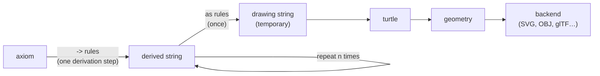

# RubberPlant L-system language

Status: **v0.2, specified**. v0.1 covers ABOP Chapter 1 (§1.1–§1.10) and is implemented. The v0.2 additions for Chapters 2–3 are marked **(v0.2)**; they are specified but not implemented yet. Geometry and output backends are specified in [`backends.md`](backends.md).

Source of truth for semantics: *The Algorithmic Beauty of Plants* (Prusinkiewicz & Lindenmayer, 1990), "ABOP" below. Section refs like §1.8 point there.

---

## 1. Overview

A RubberPlant file (`.rp`) describes one L-system:

- a **prelude** of declarations, in any order:
  - `settings { … }`: derivation count, angle, step, … (optional, at most one)
  - `let name = expr;`: named numeric constants (any number)
  - `ignore: …;`: modules skipped during context matching (optional, at most one)
  - `consider: …;` **(v0.2)**: the only modules seen during context matching (optional, at most one; not with `ignore:`)
  - `axiom: …;`: the starting string (exactly one)
- **productions**: rewrite rules, applied in parallel at each derivation step
- **interpretation rules**: rewrite rules applied once, before drawing; they never change the derived string

The prelude comes first and the rules come last. Every statement ends with `;` (only the `settings` block ends with `}`), and newlines are ordinary whitespace, so layout is free.

Example (ABOP Fig 1.6, quadratic Koch island):

```
(* Quadratic Koch island *)
settings {
  derivations = 3;
  angle = 90;
}

axiom: F-F-F-F;
F -> F-F+F+F F-F-F+F;          (* book: F-F+F+FF-F-F+F *)
```

Example (ABOP Fig 1.26, plant with flowers; the book's undefined `‘` symbol is omitted):

```
settings { derivations = 5; angle = 18; }

axiom: plant;
plant     -> internode + [ plant + flower ] - - //
             [ - - leaf ] internode [ + + leaf ] -
             [ plant flower ] + + plant flower;
internode -> F seg [ // & & leaf ] [ // ^ ^ leaf ] F seg;
seg       -> seg F seg;
leaf      -> [ ' { +f-f f-f+ | +f-f f-f } ];
flower    -> [ & & & pedicel / wedge //// wedge ////
             wedge //// wedge //// wedge ];
pedicel   -> F F;
wedge     -> [ ^F ] [ { & & & & -f+f | -f+f } ];
```

---

## 2. Lexical structure

### 2.1 Source text

- UTF-8. Line endings `\n` or `\r\n`.
- **Comments**: block comments only, F#/OCaml style: `(* … *)`. They can span lines and **nest**, so commenting out a block that already contains comments works. An unterminated comment is an error that points at its opening `(*`.
- There are no end-of-line comments. (`//` couldn't work anyway: `/` is the roll symbol and `//` is common.)
- `(*` can't start anything valid in module or expression mode (`(` followed by a binary `*`), so the comment opener is unambiguous everywhere.

### 2.2 Statements and rules

A file is a **prelude** (declarations) followed by **rules**. Both are terminated explicitly, never by newlines: newlines are ordinary whitespace everywhere, so layout is free.

**Prelude statements**, in any order and freely interleaved:

| Statement | Form | Count |
|---|---|---|
| settings | `settings { key = expr; … }` | at most one (optional) |
| constant | `let name = expr;` | any number |
| ignore list | `ignore: modules;` | at most one (optional), non-empty |
| consider list **(v0.2)** | `consider: modules;` | at most one (optional), non-empty; not together with `ignore:` |
| axiom | `axiom: modules;` | exactly one |

- `=` introduces an **expression**, `:` introduces a **module string**.
- `let`, `ignore:`, `consider:` and `axiom:` end with `;`. The `settings` block ends with its `}`, and each entry inside it ends with `;`.
- Grouping is a style choice, not a rule. By convention `axiom:` is the last item of the prelude, just before the rules.
- A `let` can only use earlier `let`s (§4.2).
- **The prelude must come before every rule.** A prelude statement after the first rule is an error ("declaration after rules").

**Rules** (productions and interpretation rules):
- End with `;`.
- Newlines are ordinary whitespace inside a rule. Layout is free: wrap long successors anywhere, align columns, or put several rules on one line.
- `->` and the rule keywords (`as`, `when`, `else`, `weight`) can't appear inside a successor. A missing `;` is therefore always detected, because the parser runs into the next rule's arrow (or a prelude keyword), and is reported as "missing `;`?".
- `#` is a reserved character with no meaning anywhere, so it is an error (§2.4).

### 2.3 Lexer modes

Tokenization depends on position, so the lexer has two modes.

| Mode | Where | Unit |
|---|---|---|
| **module mode** | after `axiom:` / `ignore:` / `consider:`, successor, context, predecessor | names and symbols |
| **expression mode** | inside a module's `( … )`, guards, weights, `let` values, setting values | numbers, identifiers, operators |

Mode switches:
- module mode → expression mode: `(` after a module name (trivia may come between: `F (1)` is `F(1)`), `when`, `weight`, the `=` of a `let` or of a settings entry
- expression mode → module mode: the matching `)` of a module's parameter list, or the `->` / `as` / `weight` that ends a guard or weight
- `axiom`, `ignore` and `consider` switch to module mode at their `:`. The `;` ends the string, and the lexer is back in prelude mode.
- Inside a `settings { … }` block every value is in expression mode. `{` and `}` are structural there and are not turtle symbols. **(v0.2)** A vector setting's value is written `( Expr , Expr , Expr )`; its parentheses and commas are punctuation (§3.2).

The same characters mean different things per mode. `+ - & ^ / | < > !` are turtle symbols in module mode and operators in expression mode (ABOP §1.10.3 notes this ambiguity too).

### 2.4 Module mode tokens

```
ModuleToken = Name | Symbol
Name        = (Letter | "_") (Letter | Digit | "_")*
Symbol      = any single non-whitespace character that is not a Letter, Digit, "_", a bracket, or reserved
```

- **Names** are maximal runs: a letter or `_`, then letters, digits or `_`. Letters include Unicode letters. `F`, `FF`, `Fl`, `seg`, `_tmp` and `apex2` are each **one** name.
- **Symbols** are always **one character** and are self-delimiting: `+ - & ^ \ / | { } ! ' ~ $ . @ ?`, and so on.
- **Brackets** `[` and `]` are one-character tokens too, but structural: they delimit branches and are never module names (§3.3).
- **Cut** `%` **(v0.2)** is a one-character structural token as well, like the brackets: it can only appear in an axiom or a production successor, never in an `as` successor, a head, a context or an `ignore:` / `consider:` list, and it takes no parameters (§3.3, §4.4). (In expression mode `%` is still the remainder operator.)
- **(v0.2)** The keyword `empty` is the empty string (ABOP's `ε`): `S -> empty;` erases `S`. It is the only way to write an empty axiom or successor, and it must be the whole string: `S -> ;` is a syntax error that suggests `empty`, and `S -> A empty B;` is a syntax error. An empty branch `[ ]` is still allowed. `derive` prints an empty string as `empty`, so its output can be read back as an axiom.
- **Reserved in module mode**: ``( ) , # : < > * = ; ` `` and the arrow `->`. `#` has no meaning anywhere, so it is an error. (cpfg used `#` to increase width; it may get a meaning in rules later.) The backtick `` ` `` (book's `‘`) has no defined meaning (§7), so using it is an error. `:` is also the colon after `axiom` / `ignore` and the start of a branch list. `<` and `>` only matter in predecessors, and `*` only as a context wildcard, but they are reserved everywhere to keep the lexer simple.
- **Digits** can't start a name, and a bare number is a syntax error in module mode. Numbers only appear inside `( … )`.

**Tokenization rule: maximal munch, no declarations.**
1. Skip whitespace.
2. If the input starts with `->`, emit an arrow.
3. If it starts with a letter or `_`, consume the longest name.
4. Otherwise emit a bracket, the cut `%` (v0.2), or one symbol character, or report a reserved character.

Tokenization never depends on declarations or other context. Whitespace is only needed **between two names**.

| Source | Tokens |
|---|---|
| `F-F+F` | `F` `-` `F` `+` `F` |
| `FF` | `FF` (one name) |
| `F F` | `F` `F` |
| `Fb[+Fa]Fa` | `Fb` `[` `+` `Fa` `]` `Fa` |
| `//` | `/` `/` |
| `B(2)A(4,4)` | `B(2)` `A(4,4)`: `)` ends the first module |
| `seg F seg` | `seg` `F` `seg` |
| `- -> +` | `-` `->` `+` |
| `~H(1)` | `~` `H(1)` |

Transcribing book text: put spaces between adjacent letters that are separate modules. `FF` → `F F`, `FlFl` → `Fl Fl`, and `ABC` → `A B C`.

### 2.5 Expression mode tokens

```
Number     = Digits [ "." Digits ] [ Exponent ] | "." Digits [ Exponent ]
Exponent   = ("e" | "E") [ "+" | "-" ] Digits
Ident      = (Letter | "_") (Letter | Digit | "_")*
Operator   = "+" | "-" | "*" | "/" | "%" | "^"
           | "<" | "<=" | ">" | ">=" | "==" | "!="
           | "!" | "&&" | "||"
Reserved   = "=" | "&" | "|"          (* no meaning in expressions yet *)
Punct      = "(" | ")" | ","
```

`.33` is a valid number (ABOP writes probabilities that way).

`->` is a single token in expression mode too, so `when y > 3 -> …` and `weight 1 -> …` end cleanly. An expression also ends at any keyword (`as`, `weight`, …), since an identifier can't directly follow a complete expression.

### 2.6 Keywords

All keywords are **fully reserved**: none can be used as a module name, a `let` name or a parameter name.

**Declaration keywords:**

```
settings  let  ignore  consider  axiom           (* consider: v0.2 *)
include  module                                  (* reserved, not yet used *)
```

`module` is reserved for future module declarations, and `include` for Chapter 5 (predefined surfaces).

**Rule keywords**, inside rules (§3.4):

```
as  when  else  weight
```

**String keyword (v0.2)**, wherever a module string is expected (axiom, successors):

```
empty
```

**Setting names** are reserved too, in every context:

```
derivations  angle  step  width  taper
tropism  elasticity                              (* v0.2 *)
```

They can't be a module name, a `let` name, a parameter name or anything else. The `settings` block is the only place they can appear.

**Built-in function names** are reserved as well (§4.1). There are no built-in constants.

### 2.7 Unicode aliases

So book text can be pasted with minimal editing, the lexer normalizes:

| Book | RubberPlant |
|---|---|
| `→` | `->` |
| `−` (U+2212 minus) | `-` |
| `∧` | `^` |
| `∼` | `~` |
| `’` (U+2019) | `'` |
| `‘` (U+2018) | `` ` `` (reserved; error) |
| `≤` / `≥` / `≠` | `<=` / `>=` / `!=` |

Subscripts can't survive plain text, so book `F`<sub>l</sub> is written as the name `Fl`, plus an interpretation rule if it should draw like `F` (§4.6).

---

## 3. Grammar

EBNF. Quoted strings are literal tokens. This section explains the grammar piece by piece; the complete, authoritative version is in [Appendix A](#appendix-a-complete-grammar).

### 3.1 File

```ebnf
File        = { Prelude } { Rule ";" } ;
Prelude     = Settings | Let | Ignore | Consider | Axiom ;
Rule        = Production | Interpretation ;
```

The prelude items can come in any order, and can be interleaved. Their counts are checked after parsing: at most one `settings`, at most one `ignore` or `consider` (not both), exactly one `axiom`. All of them come before the first rule.

### 3.2 Prelude

```ebnf
Settings    = "settings" "{" { SettingEntry } "}" ;
SettingEntry = ScalarKey "=" Expr ";"
            | VectorKey "=" Vector ";" ;                 (* v0.2 *)
ScalarKey   = "derivations" | "angle" | "step" | "width" | "taper"
            | "elasticity" ;                             (* v0.2 *)
VectorKey   = "tropism" ;                                (* v0.2 *)
Vector      = "(" Expr "," Expr "," Expr ")" ;

Let         = "let" Ident "=" Expr ";" ;

Ignore      = "ignore" ":" ModuleName { ModuleName } ";" ;
Consider    = "consider" ":" ModuleName { ModuleName } ";" ;   (* v0.2 *)

Axiom       = "axiom" ":" ActualString ";" ;
```

`let` defines a **numeric constant** whose value is an expression, evaluated once (§4.2). It isn't a macro: no text substitution happens. `ignore:` and `consider:` can't be empty, so omit them when there's nothing to list.

**(v0.2)** The grammar decides the shape of a setting's value from its key: `tropism` takes a vector, every other key a single expression. `tropism = 1;` and `angle = (1, 2, 3);` are syntax errors. Vectors exist only as setting values: they aren't expressions, and `let` can't name one.

### 3.3 Module strings

```ebnf
ActualString  = "empty" | ActualElem { ActualElem } ;   (* axiom, successors; "empty": v0.2 *)
ActualElem    = ActualModule | "[" { ActualElem } "]" | "%" ;   (* "%": v0.2 *)
ActualModule  = ModuleName [ "(" Expr { "," Expr } ")" ] ;

LeftContext   = LeftElem { LeftElem } ;           (* no brackets: a path toward the root *)
LeftElem      = FormalModule | "*" ;
RightContext  = RightElem { RightElem } ;
RightElem     = FormalModule | "*" | "[" RightContext "]" ;
FormalModule  = ModuleName [ "(" Pattern { "," Pattern } ")" ] ;   (* see 3.4.1 *)

ModuleName    = Name | Symbol ;                   (* see 2.4; never "[" or "]" *)
```

`[` and `]` are structural, not module names: the grammar itself guarantees that axioms, successors and right contexts have **balanced brackets**, and that left contexts have none. `ignore:` and `consider:` lists can't contain brackets either.

**(v0.2)** The cut `%` is structural too. The grammar only allows it in an `ActualString` (axioms and production successors), so it can't be rewritten (no head can name it), can't be matched as context, can't be listed in `ignore:` / `consider:`, can't have parameters, and can't appear in an `as` successor, where it would have no effect (§4.4).

```ebnf
InterpString  = "empty" | InterpElem { InterpElem } ;   (* as successors: no cut; v0.2 *)
InterpElem    = ActualModule | "[" { InterpElem } "]" ;
```

### 3.4 Rules

Two kinds of rule: **productions** (`->`, applied at every derivation step) and **interpretation rules** (`as`, applied once before drawing, §4.6). The grammar keeps them separate, so one rule can't mix `->` and `as` branches.

```ebnf
Production     = Head ( "->" ActualString                 (* simple form *)
                      | ":" ProdBranches ) ;
Interpretation = Head ( "as" InterpString                 (* simple form *)
                      | ":" InterpBranches ) ;

Head           = [ LeftContext "<" ] FormalModule [ ">" RightContext ] ;

(* production branches: all guarded, or all weighted *)
ProdBranches   = GuardBranch  { GuardBranch }  [ ProdElse ]
               | GWeightBranch { GWeightBranch } [ ProdElse ]          (* every branch guarded: else allowed *)
               | { GWeightBranch } UWeightBranch { WeightBranch } ;    (* some branch unguarded: no else *)
GuardBranch    = "when" Expr "->" ActualString ;
GWeightBranch  = "when" Expr "weight" Expr "->" ActualString ;
UWeightBranch  = "weight" Expr "->" ActualString ;
WeightBranch   = GWeightBranch | UWeightBranch ;
ProdElse       = "else" "->" ActualString ;

(* interpretation branches: guards only, no weights *)
InterpBranches = InterpGuard { InterpGuard } [ InterpElse ] ;
InterpGuard    = "when" Expr "as" InterpString ;
InterpElse     = "else" "as" InterpString ;
```

What the grammar enforces:
- A rule is **either** a production **or** an interpretation, never both.
- **Simple form** (`Head -> succ` / `Head as succ`): one unconditional successor, no colon.
- **Branch form** (`Head : …`): the colon opens a branch list. A branch list has at least one `when` or `weight` branch.
- A production's branches are **all deterministic** (`when`) or **all stochastic** (`weight`). Stochastic branches may also have a guard.
- `else` is optional, and only allowed **last**.
- In a weighted rule, `else` is only allowed if **every** branch has a guard. An unguarded weighted branch is always eligible, so `else` could never fire.
- Interpretation rules have no weights. (Random appearance would be redrawn independently every time the string is drawn. Revisit later if needed.)

Checked at evaluation time, not by the grammar:
- Weights are finite, non-negative numbers, and at least one is positive when evaluated.

Examples:

```
F -> F[+F]F[-F]F;                        (* D0L *)
b < a -> b;                              (* 1L, left context *)
Fu < Fa > Fa -> Fu;                      (* 2L, multi-letter names *)
* < + > * -> -;                          (* wildcard contexts *)
B(0) -> C;                               (* literal pattern *)
A(_, y) -> A(1, y);                      (* wildcard pattern *)

A(t) : when t > 5 -> B(t+1);             (* one guard *)
A(x, y) :
    when y <= 3 -> A(x*2, x+y)
    when y <= 9 -> A(x, y-1)
    else        -> B(x) A(x/y, 0);
A(x) < B(y) > C(z) : when x+y+z > 10 -> E((x+y)/2) F((y+z)/2);

F :                                      (* stochastic (no else: branches unguarded) *)
    weight 1 -> F[+F]F[-F]F
    weight 1 -> F[+F]F
    weight 1 -> F[-F]F;
A(t) :                                   (* guarded + weighted *)
    when t > 3 weight 2 -> B(t)
    when t > 3 weight 1 -> C(t)
    else                -> A(t+1);

Fl as F;                                 (* interpretation *)
leaf(s) :
    when s < 1 as F
    else       as [ { +f-f f-f+ } ];
```

### 3.4.1 Parameter patterns

Formal parameters in a head (strict predecessor and contexts) are patterns:

```ebnf
FormalModule = ModuleName [ "(" Pattern { "," Pattern } ")" ] ;
Pattern      = Ident                       (* binds the value *)
             | [ "-" ] Number              (* matches only that exact value *)
             | "_" ;                       (* matches anything, binds nothing *)
```

- A literal pattern compares with exact float equality. That's safe for integer-like counters (`a(0)`), and risky for computed values.
- `_` can appear several times in one head.
- A plain `_` in a pattern is the wildcard. Names that start with `_` (`_tmp`) are ordinary identifiers.
### 3.5 Expressions

Precedence from lowest to highest:

```ebnf
Expr     = Or ;
Or       = And   { "||" And } ;
And      = Not   { "&&" Not } ;
Not      = "!" Not | Rel ;
Rel      = Add   [ RelOp Add ] ;                   (* non-associative *)
RelOp    = "<" | "<=" | ">" | ">=" | "==" | "!=" ;
Add      = Mul   { ("+" | "-") Mul } ;
Mul      = Unary { ("*" | "/" | "%") Unary } ;
Unary    = "-" Unary | Pow ;
Pow      = Atom  [ "^" Unary ] ;                   (* right-assoc; -2^2 = -4 *)
Atom     = Number
         | Ident
         | Ident "(" [ Expr { "," Expr } ] ")"     (* built-in function *)
         | "(" Expr ")" ;
```

- C-style operators, one spelling each: `==` for equality, `&&`, `||` and `!` for logic.
- `=`, `&` and `|` are reserved in expressions, with no meaning yet. A stray `=` gets a helpful error: "use `==` for comparison".
- Transcribing ABOP: `t=0` → `t == 0`, `a & b` → `a && b`, `a | b` → `a || b`.

---

## 4. Semantics

### 4.1 Values

- Every value is a 64-bit float.
- Relational and logical operators return `1` (true) or `0` (false). Any non-zero value is true (ABOP §1.10.1).
- Division by zero, or a NaN result, is a runtime error that reports the production and module involved.
- Infinite results are allowed in expressions (`log(0)` is −∞). They're rejected where a finite value is required: weights (§4.4), widths and other turtle parameters (§5.2).

**Built-in functions (v0.1):** `sin cos tan asin acos atan atan2 sqrt exp log abs floor ceil round min max`. Trigonometry is in **degrees**, to match the turtle. `atan2(y, x)`, `min(a, b)` and `max(a, b)` take two arguments; the others take one. `round` rounds halves away from zero: `round(2.5)` is 3, `round(-2.5)` is −3.

### 4.2 Names and scope

- `let` constants are global numeric constants (not macros). They are evaluated in **source order**, and may reference only **earlier** `let`s. A forward reference is an error ("`b` used before its definition"). Settings aren't values and can't be referenced.
- Settings values, `let` values and the axiom's parameters are constant expressions: they may use numbers, operators, built-in functions and earlier `let`s.
- **Source order everywhere in the prelude.** Every prelude statement sees only the `let`s defined **before** it, the axiom included: `axiom: F(k); let k = 2;` is an error, while `let k = 2; axiom: F(k);` is fine. Rules come after the whole prelude, so they see every `let`. (This matches F#, where a `let` is only visible below its definition.)
- Formal parameters are bound by the head (left context, strict predecessor, right context). They are visible in guards, weights and successors.
- Formal parameter names in one head must be distinct (`_` excepted).
- **One namespace, no shadowing.** A name has exactly one role in the file. These roles are mutually exclusive:
  - a module name (used anywhere in the file, or predefined by the turtle: `F`, `f`, …)
  - a `let` constant
  - a formal parameter
  - a built-in function (`sin`, `max`, …)
  - a setting name (`derivations`, `angle`, `step`, `width`, `taper`, `tropism`, `elasticity`)
  - a keyword (§2.6)

  Any clash is a compile-time error, e.g. "`L` is used as a module (line 12) and as a `let` (line 3)". Modules aren't declared, so the module checks run after the whole file is parsed.
- Names are case-sensitive: `h` (parameter) and `H` (module) are different names. The book's convention of uppercase or word modules and lowercase parameters avoids clashes naturally.
- Formal parameters are local to their rule, so the same `x` can appear in many rules. That isn't shadowing, because each rule is its own scope.
- A `let` name is defined once. Redefining it is an error.
- No namespaces.

### 4.3 Modules

- A module is a name plus zero or more real parameters: `A`, `F(1.5)`, `B(2, 3)`.
- A formal module **matches** an actual module when the names are equal **and** the parameter counts are equal (ABOP §1.10.1).
- A module's identity is its **name plus parameter count**: `A`, `A(1)` and `A(2, 3)` are three different modules. A rule for `A(t)` never matches a bare `A` or `A(2, 3)`.
- The turtle is the exception: it looks at the name only, and reads the first parameter if there is one (§5.2). `F`, `F(2)` and `F(2, 3)` all draw a segment.

### 4.4 Derivation

One derivation step rewrites every module of the current string **in parallel** (ABOP §1.2). For each module *m*:

1. **Matching rules.** A production *matches* *m* when its strict predecessor matches *m* (name, parameter count, patterns; §3.4.1, §4.3) and its contexts match (§4.5). Bind the head's parameters.
2. **Order.** Try matching rules **with context first**, then rules without context (ABOP §1.8). Within each group, use source order.
3. **Branches.** For the first rule in that order that *fires*:
   - **Simple form:** always fires.
   - **Guarded:** the first `when` branch whose guard is true fires. Otherwise `else` fires if present.
   - **Weighted:** the eligible branches are those whose guard is true, or that have no guard. If there are any, pick one at random with probability proportional to its weight (weights are normalized and don't need to sum to 1; a zero weight never fires). Otherwise `else` fires if present.
   - If nothing fires (every guard is false and there is no `else`), **fall through** to the next matching rule.
4. **No rule fires:** *m* is copied unchanged (identity production).
5. Evaluate the successor's parameter expressions with the bound values, and substitute the result for *m*.

Consequences:
- Stochastic alternatives for one predecessor go in **one** weighted rule. A second unguarded rule for the same predecessor never fires; that's a lint warning.
- Book systems whose conditions are mutually exclusive work the same whatever the rule order.

Randomness comes from an explicit seed, supplied by the host (CLI), not by the file. The same seed and source always produce the same result.

`derivations = n` (in `settings`) runs *n* steps starting from the axiom.

#### Cutting branches (v0.2)

`%` cuts off the remainder of a branch (ABOP §3.3.1, Fig 3.5: petals fall when the fruit forms). As in cpfg and lpfg (checked in their source: `generate.c`, `lderive.cpp`), the cut happens in the derivation step **after** the one that produced the `%`. When a step meets a `%` in the string it is rewriting, it drops that `%` and everything after it up to the end of its branch: up to, but not including, the `]` that closes the branch containing the `%`, or to the end of the string at the top level. The dropped modules aren't rewritten, and complete branches inside the dropped part go with it, so brackets stay balanced.

```
string at step n:     A [ B % C [ D ] E ] F
string at step n+1:   a [ b ] f              (a, b, f: the successors of A, B, F)
```

Consequences:
- The `%` and the doomed part stay in the string for one step: `derive` prints them, and the turtle draws them, because the turtle ignores `%` (as cpfg does by default, and lpfg always). In Capsella (Fig 3.5) the newest fruit keeps its petals for one step, as in the book.
- A `%` in the axiom takes effect in the first step; with `derivations = 0` nothing is cut.
- During context matching, a `%` in the string is a module that no formal module can name (the grammar keeps `%` out of heads and contexts), so only `*` matches it. It can't be listed in `ignore:` or `consider:`.
- `%` has no effect on drawing, so the grammar keeps it out of `as` successors (§3.3). cpfg ignores it there too.

### 4.5 Context matching

**Ignore list.** Modules listed in `ignore:` don't exist during context matching (ABOP §1.8, `#ignore`). Brackets can't be ignored.

**Consider list (v0.2).** `consider:` is the complement of `ignore:` (ABOP L-system 3.3, `#consider`; lpfg §2.2.4): when it is given, **only** the listed modules exist during context matching, and every other module is skipped as if it were ignored. Brackets always exist. A file has at most one of `ignore:` and `consider:`; both is an error. Neither list affects the strict predecessor: a rule for `A(t)` matches every `A(t)` whether or not `A` is listed. Below, "ignored" means "listed in `ignore:`" or "not listed in `consider:`".

**Wildcard.** `*` as a context element matches any single module that isn't ignored (ABOP Fig 1.31). There must be one: `*` never matches nothing, and never a bracket.

**Left context** (ABOP §1.8, Fig 1.29). Match the formal left context right-to-left, walking left from *m*:
- Skip ignored modules.
- Skip complete bracketed branches `[ … ]` found to the left. They are siblings, not ancestors.
- On a `[`, step past it and keep going: the module before a branch is its parent.
- The left context is a path toward the root, so it contains no brackets (enforced by the grammar, §3.3).

**Right context.** Match the formal right context left-to-right, walking right from *m*:
- Skip ignored modules.
- A formal `[` matches the next actual `[` (after ignored modules); the match continues inside that branch, and a formal `]` returns to the parent axis. Branch order matters: if that branch doesn't match, later sibling branches aren't tried.
- When the formal string expects a module but the actual string has a `[` that the formal doesn't mention, skip the whole branch.
- On an unmatched actual `]` (end of the current branch), matching fails.

Example from ABOP: the head `B C < S > G [ H ] M` matches `S` in `A B C [D E] [S G [H I [J K] L] M N O]`. Matching skips `[DE]` on the left, and skips `I[JK]L` inside the `[H…]` branch on the right.

**Parameters** in contexts bind like those of the strict predecessor.

### 4.6 Interpretation rules

`Head as Successor` rules ("draw *Head* as *Successor*") translate the final derived string into a temporary **drawing string** for the turtle. L-Py calls this the *interpretation* or *homomorphism* section.



- `->` productions build the derived string. That's the **model**: what the plant *is*.
- `as` rules produce a throwaway copy for drawing. That's the **appearance**: how the plant *looks*.
- The derived string is never modified by `as` rules.

Example (ABOP Fig 1.10a, dragon curve):

```
axiom: Fl;
Fl -> Fl + Fr +;
Fr -> - Fl - Fr;
Fl as F;
Fr as F;
```

```
step 0:   Fl
step 1:   Fl + Fr +
step 2:   Fl + Fr + + - Fl - Fr +      ← derived string
drawing:  F + F + + - F - F +          ← after as rules; the turtle draws this
```

`Fl` and `Fr` rewrite differently but look the same. Without the `as` rules the turtle would ignore both and draw nothing. Writing `Fl -> F` as a production would also fail, because `Fl` would disappear and the curve would stop growing.

Interpretation rules:

1. **Use the same matching as productions**: contexts, patterns, guards. Appearance can depend on state:
   ```
   leaf(age) :
       when age < 3 as F(0.5)                         (* young leaf: short stub *)
       else         as [ { +f-f f-f+ | +f-f f-f } ];  (* mature leaf: polygon *)
   ```
2. **Are applied in a single parallel pass and never iterated.** The output of an `as` rule isn't translated again:
   ```
   A as B;
   B as F;
   ```
   An `A` draws as `B` (invisible to the turtle), **not** as `F`. Modules without a matching `as` rule pass through unchanged. (lpfg allows deeper translation via `maximum depth:`; we may add that later.)
3. **Never feed back** into derivation. Step *n*+1 is derived from the derived string, never from the drawing string. When animating, interpretation runs separately on each displayed step.

### 4.7 Settings

The optional `settings { … }` block holds scalar configuration. Every key is optional and has a default. An unknown key, or a key set twice, is an error.


| Key | Meaning | Default |
|---|---|---|
| `derivations` | number of derivation steps *n* | `0` |
| `angle` | default angle increment δ, degrees | `90` |
| `step` | default step length *d* | `1` |
| `width` | initial line width; finite and non-negative | `1` |
| `taper` | width decrement applied by each bare `!`, as a **percentage**: the width is multiplied by (1 − taper/100). Must be in [0, 100]. | `30` |
| `tropism` **(v0.2)** | direction of the tropism vector **T**, in world coordinates (§5.1); a vector `(x, y, z)` with finite components, not all zero. Only its direction matters: it is normalized (§5.5). | `(0, -1, 0)` (gravity) |
| `elasticity` **(v0.2)** | elasticity *e*: how strongly segments bend toward **T** (§5.5). Finite; negative values bend away from **T**. `0` disables tropism. | `0` |

A CLI flag overrides the file value. The random **seed** isn't part of the language; it is a run parameter supplied by the host (default `0`): an integer with \|seed\| ≤ 2<sup>53</sup> − 1 (exact as a float).

---

## 5. Turtle interpretation

### 5.1 State

The turtle state is:
- position **P** (3D)
- orientation frame **H** (heading), **L** (left), **U** (up), with **H** × **L** = **U** (ABOP §1.5)
- line width
- color index
- an optional polygon being collected

**Initial state:** P = (0,0,0), H = (0,1,0) (facing up, ABOP Fig 1.5), L = (−1,0,0), U = (0,0,1). Looking down −U onto the XY plane, this gives ABOP's 2D behavior: `+` turns counter-clockwise.

**World coordinates (v0.2).** The world is right-handed with **+Y up**: the turtle starts growing upward, the direction opposite to gravity is **V** = (0, 1, 0) (used by `$`, §5.2), and gravity is (0, −1, 0). This matches ABOP's tropism vectors (Table 2.3 gives gravity as (0, −1, 0)) and glTF's convention, so backends never convert axes. Front views look down −Z, with +X to the right.

Rotations use ABOP's matrices R<sub>U</sub> and R<sub>L</sub> (§1.5) with **H, L, U as the rows** of the frame: [H; L; U]′ = R · [H; L; U]. (Read with H, L, U as columns, ABOP's printed equation would turn `+` the wrong way.) R<sub>H</sub> follows cpfg instead (see below). Concretely, for an angle *a*:

| Rotation | Effect |
|---|---|
| R<sub>U</sub>(*a*), turn left | H′ = H cos *a* + L sin *a*; L′ = L cos *a* − H sin *a* |
| R<sub>L</sub>(*a*), pitch down | H′ = H cos *a* − U sin *a*; U′ = U cos *a* + H sin *a* |
| R<sub>H</sub>(*a*), roll left | L′ = L cos *a* + U sin *a*; U′ = U cos *a* − L sin *a* |

**Roll direction (v0.2).** `+`, `-`, `&` and `^` turn the same way as in cpfg, the software that made ABOP's figures. For the roll, ABOP's printed R<sub>H</sub> read the same way would turn the opposite way from cpfg (cpfg's frame starts with U = (0, 0, −1), and its `/` turns L toward that U, so toward −Z). RubberPlant follows cpfg: with the printed matrix, every divergence spiral winds the other way and the 3D trees of Chapter 2 don't match the book (checked against Figs 2.6a and 2.6c, which match line for line with cpfg's roll). So `/` turns L toward −U, and `\` toward +U.

### 5.2 Symbols

When a turtle symbol has parameters, the first parameter overrides the default (ABOP §1.10.3). Extra parameters are ignored, with one warning per module name and parameter count. The value a symbol consumes, whether its parameter or the setting it defaults to, must be finite, and so must the turtle's position; otherwise it's a runtime error, so backends only ever receive finite geometry. Unused parameters (the extra ones, or any parameter of `|`, `{`, `}`) are ignored, even if they aren't finite. The initial width (from `#width` or a command-line override) must be finite and non-negative.

| Symbol | Default | With parameter `(a)` | Effect |
|---|---|---|---|
| `F` | move *d*, draw | move *a*, draw | Draw a segment from P to P + a·H. Inside `{ }`, records a vertex. Then applies tropism (§5.5) |
| `f` | move *d* | move *a* | Move without drawing. Inside `{ }`, records a vertex. Then applies tropism (§5.5) |
| `G` **(v0.2)** | move *d*, draw | move *a*, draw | Like `F`, but never records a polygon vertex (ABOP Ch 5, p. 122, Fig 5.4). Applies tropism |
| `.` **(v0.2)** | — | — | Record the current P as a vertex of the innermost open polygon (ABOP Ch 5, p. 122) |
| `$` **(v0.2)** | — | — | Roll to horizontal: rotate around H so that L is horizontal and U points up (ABOP Ch 2, p. 57, Fig 2.6) |
| `%` **(v0.2)** | — | — | Cut. No effect on the turtle: the cut happens in the next derivation step (§4.4) |
| `+` | turn δ | turn *a* | Turn left: R<sub>U</sub>(a) |
| `-` | turn δ | turn *a* | Turn right: R<sub>U</sub>(−a) |
| `&` | pitch δ | pitch *a* | Pitch down: R<sub>L</sub>(a) |
| `^` | pitch δ | pitch *a* | Pitch up: R<sub>L</sub>(−a) |
| `\` | roll δ | roll *a* | Roll left: R<sub>H</sub>(a) |
| `/` | roll δ | roll *a* | Roll right: R<sub>H</sub>(−a) |
| `\|` | — | — | Turn around: R<sub>U</sub>(180°) |
| `[` | — | — | Push the full state |
| `]` | — | — | Pop the state. No line drawn |
| `{` | — | — | Start a new, empty polygon (ABOP p. 127). **(v0.2)** v0.1 also recorded P as the first vertex; it no longer does |
| `}` | — | — | Close and emit a filled polygon |
| `!` | width × (1 − taper/100) | width := *a* (*a* ≥ 0) | Change line width (ABOP Fig 1.25, Appendix B; parametric form from Ch 2). Bare `!` compounds: with `taper = 30`, `! !` gives width × 0.49. ABOP has no increment symbol; grow width with `!(w)` |
| `'` | color + 1 | color := *a*, truncated toward zero | Next color index (ABOP Fig 1.25). The index is a 32-bit signed integer: `'(a)` truncates, then saturates to [−2<sup>31</sup>, 2<sup>31</sup> − 1]; bare `'` stops at 2<sup>31</sup> − 1. How indices map to colors is up to the backend (SVG: a fixed palette that wraps around) |


Every other module is **ignored** by the turtle. That's what makes node-rewriting symbols like `L`, `R`, `X` and `A` work (ABOP §1.4.2).

Reserved for later chapters, with no meaning yet: `~` (predefined surface, Ch 5). The turtle ignores it, so `~K(0)` is the ignored `~` followed by a module `K(0)`, which an `as` rule can draw as a stand-in (§6).

**(v0.2) Details of the new symbols:**

- **`G`** is `F` minus the polygon vertex. ABOP introduces it in Chapter 5 but Chapter 3 already uses it: Capsella (Fig 3.5) builds its fruit as a polygon on a `G` framework, and Mycelis (L-systems 3.2–3.3) draws dormant branches with it ("G is interpreted here in the same way as F"). It is pulled forward to 0.2 for those figures. lpfg's `g` (`f` without a vertex) isn't added: no figure up to Chapter 3 needs it. Files that used `G` or `.` as plain, non-drawing modules now draw with them.
- **`.`** outside any polygon does nothing, with one warning per drawing. Extra parameters are ignored, like for every turtle symbol.
- **`$`** sets L′ = (**V** × H) / |**V** × H| and U′ = H × L′, with **V** = (0, 1, 0) (ABOP p. 57 gives these formulas). H is unchanged. U′ is the part of **V** perpendicular to H, so it points up. When H is vertical (|**V** × H| < 10<sup>−9</sup>), every L is already horizontal and the formula is undefined; `$` then does nothing, like cpfg's roll-to-horizontal (`@v`), so a roll given to a vertical stem (a divergence angle, for example) is kept. lpfg's `RollToVert` resets L to (−1, 0, 0) instead, which would discard it.
- **`%`** does nothing when drawn. The doomed part of the branch is drawn until the next derivation step removes it (§4.4), as in cpfg and lpfg.

### 5.3 Polygons

**(v0.2)** `{` starts an **empty** polygon: ABOP defines it as "creating an empty current polygon" (p. 127), and cpfg does the same. The turtle's position when `{` is read isn't a vertex unless something records it, which is why ABOP's polygons often start with `{ .`. Between `{` and `}`:
- `f` and `F` moves add their end point as a vertex.
- `F` still draws its segment.
- **(v0.2)** `G` moves and draws, but adds no vertex; `.` adds the current position as a vertex. Together they build a polygon on a framework of lines that aren't its edges (ABOP Ch 5, p. 122, Fig 5.4).
- Every recorded point is a vertex, even if it repeats the previous one; the mesh builder drops such repeats ([`backends.md`](backends.md) §4.3).
- `[` and `]` inside a polygon save and restore the turtle state, but not the vertex list. One polygon is collected per `{`.
- At `}`, the vertex list becomes a filled polygon in the current color.
- Nested `{` starts a new polygon (a stack of polygons).
- `{` and `}` are turtle modules, not structural brackets, so they can be unbalanced. A `}` with no open polygon is ignored, and polygons still open at the end of the string are dropped. Each kind of imbalance gives one warning per drawing, however many times it occurs.

### 5.4 Output

The turtle produces backend-neutral **geometry**:
- `Segment(p0, p1, width, color)`
- `Polygon(vertices, color)`

**(v0.2)** In 3D a segment is an **open cylinder** (a tube without end caps) of diameter `width` from p0 to p1, as in ABOP's own software (cpfg's and lpfg's cylinder line style). Mesh backends tessellate it; the SVG backend draws a line with straight (butt) ends, like the book's figures. Polygons are flat-shaded, two-sided, and may be concave. Widths are in *width units*: pixels for SVG, and world units times a scale factor for mesh backends (ABOP's widths are line widths in pixels, as in Fig 2.6, where a trunk 1 unit long is 10 wide). Later chapters add more primitives: generalized cylinders, surfaces.

Backends (SVG, OBJ, glTF, …) consume this geometry; see [`backends.md`](backends.md). Scale and framing are backend concerns; SVG fits the drawing to the viewport, which replaces ABOP's "decrease *d* between images". SVG line widths are in pixels, so it reserves half the widest line around the drawing; if the image is too small for that, rendering fails rather than clipping.

### 5.5 Tropism (v0.2)

ABOP Ch 2 (p. 58, Fig 2.8, Fig 2.9) bends branches by "slightly rotating the turtle in the direction of a predefined tropism vector **T** after drawing each segment", by α = *e* · |H × **T**|. With **T̂** = **T** / |**T**| and *e* from the settings (§4.7), after every move (`F`, `f` and `G`):

1. Let **A** = H × **T̂**. If |**A**| < 10<sup>−9</sup> (H parallel to **T**), nothing happens.
2. Otherwise rotate the whole frame (H, L and U together) around the axis **A** / |**A**| by the angle α given by **sin α = *e* · |A|**, clamped to [−1, 1]. Rotating around H × **T̂** turns H toward **T**; a negative *e* turns it away.

Notes:
- **No angle unit is involved.** *e* is a plain coefficient, and the formula gives the sine of the bend. For the small bends of ABOP's tables, sin α ≈ α (in radians), which is the book's formula. Nothing in the language is written in radians.
- **This is what cpfg and lpfg compute** (checked in their source: `bend` in cpfg's `interpret.c`, `Turtle::_Bend` in lpfg's `turtle.cpp`). They use the same sine, but apply it as two successive rotations: toward U by the component of **T̂** along U, then toward L by its component along L. The single rotation used here agrees with that to second order, doesn't depend on the turtle's roll, and stays defined when *e* · |**A**| > 1, where the tools take the square root of a negative number.
- **T is normalized**, as in both tools: the vector gives the direction, and *e* alone gives the strength. ABOP's Table 2.3 vectors are unit vectors anyway.
- **Every move bends, `f` included**, as in both tools. ABOP says "after drawing each segment", but its figures were made with cpfg.
- Order within a move: the segment is emitted (for `F` and `G`) and the polygon vertex recorded (for `F` and `f`), then the frame bends. The bend affects the next move.
- The frame stays orthonormal: it is one rigid rotation (Rodrigues' formula) applied to all three vectors.

---

## 6. Book → RubberPlant cheat sheet

| ABOP | RubberPlant |
|---|---|
| `n=5, δ=18°` | `settings { derivations = 5; angle = 18; }` |
| `ω : F` | `axiom: F;` |
| `p1 : F → FF` | `F -> F F;` (no labels) |
| `#define R 1.456` | `let R = 1.456;` (a constant, not a macro) |
| `#ignore: +-F` | `ignore: + - F;` |
| `F` with probability .33 above the arrow | `F : weight .33 -> … weight .33 -> …;` (one rule) |
| `A(t) : t>5 → …` | `A(t) : when t > 5 -> …;` |
| `t=0`, `&`, `\|` in conditions | `t == 0`, `&&`, `\|\|` |
| `A : * → …` | `A -> …;` |
| several rules for `B(x)` with exclusive conditions | `B(x) : when … -> … else -> …;` |
| `FF`, `F1F1F1` (adjacent single letters) | `F F`, separate with spaces |
| `F`<sub>l</sub>, `F`<sub>r</sub> | names `Fl`, `Fr` + `Fl as F;` |
| bold **plant** | name `plant` |
| `/* comment */` | `(* comment *)` |
| one rule per line | every statement ends with `;`; newlines are whitespace |
| `#consider: M S T V` **(v0.2)** | `consider: M S T V;` |
| `→ ε` (empty successor) **(v0.2)** | `-> empty;` |
| indexed symbols `K`<sub>i</sub> `→` `K`<sub>i+1</sub>, `A`<sub>7</sub> **(v0.2)** | parametric `K(i) -> K(i+1);`, `A(7)` |
| `#define r`<sub>1</sub> `0.9`, `d`<sub>1</sub>, `l`<sub>r</sub> **(v0.2)** | `let r1 = 0.9;`, `d1`, `lr` |
| `(t=m)&(c<e)`, `!(t=2)` **(v0.2)** | `t == m && c < e`, `t != 2` |
| `#include K` and `∼K(t)` (predefined surface, Ch 5) **(v0.2)** | not supported yet: keep `~K(t)` and add a stand-in `K(t) as …;` |
| tropism **T**, *e* (Table 2.3) **(v0.2)** | `settings { tropism = (0, -1, 0); elasticity = 0.22; }` |

### Worked examples

ABOP L-system 1.7 (parametric):

```
settings { derivations = 4; }
axiom: B(2)A(4,4);
A(x,y) :
    when y <= 3 -> A(x*2, x+y)
    else        -> B(x) A(x/y, 0);
B(x) :
    when x < 1  -> C
    else        -> B(x-1);
```

ABOP Fig 1.30a (acropetal signal):

```
settings { derivations = 6; angle = 22.5; }
ignore: + -;
axiom: Fb[+Fa]Fa[-Fa]Fa[+Fa]Fa;
Fb < Fa -> Fb;
Fa as F;
Fb as F;
```

ABOP Fig 1.31a (Hogeweg & Hesper). The book's symbols `0` and `1` can't be names (names can't start with a digit), so they become `a` and `b`:

```
settings { derivations = 30; angle = 22.5; }
ignore: + - F;
axiom: F b F b F b;
a < a > a -> a;
a < a > b -> b[+F b F b];
a < b > a -> b;
a < b > b -> b;
b < a > a -> a;
b < a > b -> b F b;
b < b > a -> a;
b < b > b -> a;
* < + > * -> -;
* < - > * -> +;
```

ABOP Fig 1.37b (row of trees):

```
settings { derivations = 10; angle = 86; }
let c = 1;
let p = 0.3;
let q = c - p;
let h = (p*q)^0.5;
axiom: F(1,0);
F(x, 0) -> F(x*p,2) + F(x*h,1) - - F(x*h,1) + F(x*q,0);   (* literal pattern for t = 0 *)
F(x, t) -> F(x, t-1);
```

**(v0.2)** ABOP Fig 2.6a (monopodial tree; `$` keeps branch planes horizontal):

```
settings { derivations = 10; }
let r1 = 0.9;     (* contraction ratio for the trunk *)
let r2 = 0.6;     (* contraction ratio for branches *)
let a0 = 45;      (* branching angle from the trunk *)
let a2 = 45;      (* branching angle for lateral axes *)
let d  = 137.5;   (* divergence angle *)
let wr = 0.707;   (* width decrease rate *)
axiom: A(1, 10);
A(l, w) -> !(w) F(l) [ &(a0) B(l*r2, w*wr) ] /(d) A(l*r1, w*wr);
B(l, w) -> !(w) F(l) [ -(a2) $ C(l*r2, w*wr) ] C(l*r1, w*wr);
C(l, w) -> !(w) F(l) [ +(a2) $ B(l*r2, w*wr) ] B(l*r1, w*wr);
```

**(v0.2)** ABOP Fig 2.8a (ternary branching with tropism, Table 2.3 row a):

```
settings {
  derivations = 6;
  tropism = (0, -1, 0);
  elasticity = 0.22;
}
let d1 = 94.74;   (* divergence angle 1 *)
let d2 = 132.63;  (* divergence angle 2 *)
let a  = 18.95;   (* branching angle *)
let lr = 1.109;   (* elongation rate *)
let vr = 1.732;   (* width increase rate *)
axiom: !(1) F(200) /(45) A;
A    -> !(vr) F(50) [ &(a) F(50) A ] /(d1) [ &(a) F(50) A ] /(d2) [ &(a) F(50) A ];
F(l) -> F(l*lr);
!(w) -> !(w*vr);
```

**(v0.2)** ABOP Fig 3.5 (Capsella bursa-pastoris; `.`, `G` and `%`). The number of steps is chosen per example:

```
settings { derivations = 32; angle = 18; }
axiom: I(9) a(13);
a(t) :
    when t > 0  -> [ &(70) L ] /(137.5) I(10) a(t-1)
    when t == 0 -> [ &(70) L ] /(137.5) I(10) A;
A -> [ &(18) u(4) F F I(10) I(5) X(5) K K K K ] /(137.5) I(8) A;
I(t) :
    when t > 0  -> F I(t-1)
    when t == 0 -> F;
u(t) :
    when t > 0  -> &(9) u(t-1)
    when t == 0 -> &(9);
L -> [ { . - F I(7) + F I(7) + F I(7) } ] [ { . + F I(7) - F I(7) - F I(7) } ];
K -> [ & { . + F I(2) - - F I(2) } ] [ & { . - F I(2) + + F I(2) } ] /(90);
X(t) :
    when t > 0  -> X(t-1)
    when t == 0 -> ^(50) [ [ - G G G G + + [ G G G [ + + G { . ] . ] . ] .
                   + + G G G G . - - G G G . - - G . } ] %;
```

**(v0.2)** ABOP L-system 3.3 (Mycelis muralis, model III; `consider:`). `K` is a predefined surface in the book; a stand-in `as` rule draws it:

```
settings { derivations = 40; }   (* the book gives no n for model III *)
consider: M S T V;
axiom: I(20) F A(0);
S < A(t) -> T V K;
V < A(t) -> T V K;
A(t) :
    when t > 0  -> A(t-1)
    when t == 0 -> M [ +(30) G ] F /(180) A(2);
S < M -> S;
S > T -> T;
T < G -> F A(2);
V < M -> S;
T > V -> W;
W -> V;
I(t) :
    when t > 0  -> I(t-1)
    when t == 0 -> S;
K as [ '(4) { -(45) f +(90) f +(90) f } ];   (* stand-in flower: a red triangle *)
```

---

## 7. Open questions

None.

Not modeled yet:
- **Predefined surfaces** (`~`, ABOP's `#include`; Ch 5, 0.3). `~H` lexes as `~` followed by the name `H`, and the turtle ignores `~`. The Chapter 3 examples that need surfaces (crocus, Lychnis, Mycelis, lilac) draw their organs with stand-in `as` rules, marked as such in comments.
- **Table L-systems** (ABOP §3.1.2, "the effect of environment"): no figure uses them. lpfg has groups; revisit with 1.0.
- **Partial L-systems** (ABOP §3.1.1, §3.3): they are nondeterministic and have no geometry. They can be written as `weight` rules plus `as` rules, but the book's diagrams aren't transcribed as examples. The developmental sequences that the book prints in full (the signal example of §3.1.2, the lily-of-the-valley sequence of §3.3.1) are derivation tests instead.
- **Developmental sequences in one image** (Figs 3.5, 3.9, 3.10, 3.14, 3.17 show several stages side by side): deferred to animation (Ch 6, 0.3). Each example renders one stage, chosen with `derivations`.
- **Initial heading or view** (Fig 1.37b renders rotated 90°): no Chapter 2–3 figure needs it.

Temporary decisions (may be revisited):
- **Module declarations**: dropped. `module` stays reserved.
- **Multiple L-systems per file and namespaces**: dropped.
- **`` ` `` (book's `‘`, Fig 1.26)**: no meaning, not in ABOP's symbol table. Reserved; using it is an error.
- **`#`**: no meaning anywhere; reserved, using it is an error.
- **`seed`**: not part of the language; a host (CLI) parameter.
- **`taper`**: name and 30% default chosen for now (ABOP never gives the decrement amount for `!`).
- **Elasticity is global** (v0.2): a setting, not part of the turtle state. Per-branch elasticity (cpfg's `_`, lpfg's `SetElasticity`) can be added later without breaking files: the setting would become the initial value.
- **No `g`** (v0.2): lpfg's `f` without a polygon vertex; no figure up to Chapter 3 needs it.

---

## Appendix A. Complete grammar

This appendix is the **authoritative** grammar. §2 and §3 explain it piece by piece; if they disagree with this appendix, the appendix wins.

Notation: ISO-style EBNF. `"x"` is a literal, `{ x }` means zero or more, `[ x ]` optional, `( x | y )` alternatives, `? … ?` a prose description. `(* … *)` is an EBNF comment (also our language's comment syntax).

### A.1 Lexical grammar

Characters and trivia:

```ebnf
Letter        = ? any Unicode letter (general category L*) ? ;
Digit         = "0" | "1" | "2" | "3" | "4" | "5" | "6" | "7" | "8" | "9" ;
Digits        = Digit { Digit } ;
Newline       = "\n" | "\r\n" ;
Space         = " " | "\t" ;

Comment       = "(*" { Comment | CommentChar } "*)" ;         (* nests *)
CommentChar   = ? any character, unless it starts "(*" or "*)" ? ;

Trivia        = Space | Newline | Comment ;    (* between tokens; newlines are never significant *)
```

Tokens shared by both modes:

```ebnf
Name          = ( Letter | "_" ) { Letter | Digit | "_" } ;    (* maximal munch *)
Arrow         = "->" ;
```

Reserved names (never a module name, `let` name, parameter or function name):

```ebnf
DeclKeyword   = "settings" | "let" | "ignore" | "consider" | "axiom" | "include" | "module" ;
RuleKeyword   = "as" | "when" | "else" | "weight" ;
StringKeyword = "empty" ;
SettingName   = "derivations" | "angle" | "step" | "width" | "taper"
              | "tropism" | "elasticity" ;
BuiltinName   = "sin" | "cos" | "tan" | "asin" | "acos" | "atan" | "atan2" | "sqrt"
              | "exp" | "log" | "abs" | "floor" | "ceil" | "round" | "min" | "max" ;
Reserved      = DeclKeyword | RuleKeyword | StringKeyword | SettingName ;   (* BuiltinName only as a call *)
Wildcard      = "_" ;                (* a lone "_"; only valid as a Pattern *)
```

Module mode (after `axiom:` / `ignore:` / `consider:`, successors, contexts, predecessors):

```ebnf
Symbol        = ? any single character that is not whitespace, Letter, Digit, "_",
                  a Bracket, the Cut, or a ModReserved character ? ;
Bracket       = "[" | "]" ;
Cut           = "%" ;                (* structural, like brackets *)
ModReserved   = "(" | ")" | "," | "#" | ":" | "<" | ">" | "*" | "=" | ";" | "`" ;
                (* "(" ")" "," ":" "<" ">" "*" ";" are punctuation;
                   "#" "=" "`" have no meaning and are errors *)
```

Expression mode (module parameters, guards, weights, `let` and settings values, vector components):

```ebnf
Number        = ( Digits [ "." Digits ] | "." Digits ) [ Exponent ] ;
Exponent      = ( "e" | "E" ) [ "+" | "-" ] Digits ;
Ident         = Name ;               (* not Reserved, not a lone "_" *)
Operator      = "+" | "-" | "*" | "/" | "%" | "^"
              | "<" | "<=" | ">" | ">=" | "==" | "!="
              | "!" | "&&" | "||" ;
ExprReserved  = "=" | "&" | "|" | "#" ;    (* errors; "=" suggests "==" *)
Punct         = "(" | ")" | "," ;
```

Unicode normalization, applied before tokenizing (outside comments):

```ebnf
(* "→" ⇒ "->"   "−" (U+2212) ⇒ "-"   "∧" ⇒ "^"   "∼" ⇒ "~"
   "’" (U+2019) ⇒ "'"   "‘" (U+2018) ⇒ "`" (reserved, error)
   "≤" ⇒ "<="   "≥" ⇒ ">="   "≠" ⇒ "!=" *)
```

### A.2 Syntactic grammar

File structure:

```ebnf
File            = { Prelude } { Rule ";" } EndOfFile ;
Prelude         = Settings | Let | Ignore | Consider | Axiom ;
Rule            = Production | Interpretation ;
```

Prelude:

```ebnf
Settings        = "settings" "{" { SettingEntry } "}" ;
SettingEntry    = ScalarKey "=" Expr ";" | VectorKey "=" Vector ";" ;
ScalarKey       = "derivations" | "angle" | "step" | "width" | "taper" | "elasticity" ;
VectorKey       = "tropism" ;
Vector          = "(" Expr "," Expr "," Expr ")" ;
Let             = "let" Ident "=" Expr ";" ;
Ignore          = "ignore" ":" ModuleName { ModuleName } ";" ;
Consider        = "consider" ":" ModuleName { ModuleName } ";" ;
Axiom           = "axiom" ":" ActualString ";" ;
                  (* "include" and "module" are reserved, not yet valid *)
```

Module strings:

```ebnf
ModuleName      = Name | Symbol ;              (* Name: not Reserved, not a BuiltinName, not a lone "_" *)

ActualString    = "empty" | ActualElem { ActualElem } ;      (* axioms, production successors *)
ActualElem      = ActualModule | "[" { ActualElem } "]" | "%" ;
InterpString    = "empty" | InterpElem { InterpElem } ;      (* as successors: no cut *)
InterpElem      = ActualModule | "[" { InterpElem } "]" ;
ActualModule    = ModuleName [ "(" Expr { "," Expr } ")" ] ;

LeftContext     = LeftElem { LeftElem } ;
LeftElem        = FormalModule | "*" ;
RightContext    = RightElem { RightElem } ;
RightElem       = FormalModule | "*" | "[" RightContext "]" ;

FormalModule    = ModuleName [ "(" Pattern { "," Pattern } ")" ] ;
Pattern         = Ident | [ "-" ] Number | Wildcard ;
```

Rules:

```ebnf
Head            = [ LeftContext "<" ] FormalModule [ ">" RightContext ] ;

Production      = Head ( "->" ActualString | ":" ProdBranches ) ;
ProdBranches    = GuardBranch { GuardBranch } [ ProdElse ]
                | GWeightBranch { GWeightBranch } [ ProdElse ]
                | { GWeightBranch } UWeightBranch { WeightBranch } ;
GuardBranch     = "when" Expr "->" ActualString ;
GWeightBranch   = "when" Expr "weight" Expr "->" ActualString ;
UWeightBranch   = "weight" Expr "->" ActualString ;
WeightBranch    = GWeightBranch | UWeightBranch ;
ProdElse        = "else" "->" ActualString ;

Interpretation  = Head ( "as" InterpString | ":" InterpBranches ) ;
InterpBranches  = InterpGuard { InterpGuard } [ InterpElse ] ;
InterpGuard     = "when" Expr "as" InterpString ;
InterpElse      = "else" "as" InterpString ;
```

Expressions (lowest to highest precedence):

```ebnf
Expr            = Or ;
Or              = And { "||" And } ;
And             = Not { "&&" Not } ;
Not             = "!" Not | Rel ;
Rel             = Add [ RelOp Add ] ;                     (* non-associative *)
RelOp           = "<" | "<=" | ">" | ">=" | "==" | "!=" ;
Add             = Mul { ( "+" | "-" ) Mul } ;
Mul             = Unary { ( "*" | "/" | "%" ) Unary } ;
Unary           = "-" Unary | Pow ;
Pow             = Atom [ "^" Unary ] ;                    (* right-assoc; -2^2 = -4 *)
Atom            = Number
                | Ident [ "(" [ Expr { "," Expr } ] ")" ]   (* constant, parameter, or built-in call *)
                | "(" Expr ")" ;
```

### A.3 Constraints outside the grammar

These can't be expressed in a context-free grammar. They're checked after parsing, or at evaluation time.

**After parsing (compile-time errors):**
- **Prelude counts:** exactly one `axiom:` (its string may be `empty`); at most one `settings` block; at most one `ignore:` or `consider:`, and never both.
- **Prelude before rules:** a prelude statement after the first rule ("declaration after rules").
- **Settings keys:** each key at most once. (Unknown keys are already excluded by the grammar.)
- **Reserved words** (`Reserved`, built-in function names) are never a module name, `let` name or parameter name.
- **One namespace, no shadowing.** A name has exactly one role: module (or turtle-predefined), `let` constant, formal parameter, built-in function, setting name or keyword (§4.2).
- Formal parameter names in one head are distinct (`_` excepted).
- `let` names are unique. A `let` value, a settings value and the axiom's parameters only use `let`s defined **earlier** in the source (§4.2).
- A function call names a built-in function with the right number of arguments.

**At evaluation time (runtime errors):**
- Weights are finite and non-negative, and at least one eligible weight is positive.
- Turtle parameters are finite, `!(w)` has *w* ≥ 0, and the turtle's position stays finite.
- No division by zero and no NaN results.
- `taper` is in [0, 100]; `derivations` is a non-negative integer; `width` is finite and non-negative; `elasticity` and the components of `tropism` are finite, and `tropism` isn't the zero vector; the host-supplied seed is an integer with |seed| ≤ 2<sup>53</sup> − 1.

### A.4 Parsing notes

- **Lexer modes.** Module mode and expression mode tokenize differently (§2.3). The parser drives the switch: expression mode is entered for a module's `( … )`, after `when` / `weight`, after the `=` of a `let` or settings entry; module mode after the `:` of `axiom` / `ignore` / `consider`.
- **Lookahead.** `GuardBranch` and `GWeightBranch` share the prefix `"when" Expr`. The parser decides after the guard, on `->` (guard) or `weight` (weighted). Everything else is LL(1). A prelude statement is recognized by its leading keyword. Since keywords are fully reserved, no rule can start with one.
- **No line sensitivity.** Newlines are trivia everywhere.
- **`(*`** always opens a comment, in every mode. It can't start anything valid in the grammar.
